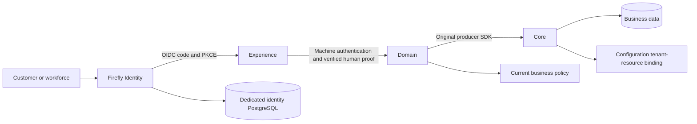

# Firefly Identity

Firefly Identity provides customer identity and access management (CIAM) for OpenPlatform and the wider Firefly ecosystem. It gives customers a consistent place to sign in, manage their account and recover access, while keeping employee and administrative identities under separate security policies. It combines a branded Keycloak distribution, dedicated identity storage, a reproducible sandbox and explicit application integration contracts.

The distribution packages Keycloak 26.8.1 through supported themes and configuration. OpenPlatform applications retain their business identities, permissions, consent, and persistence. Jafly remains an independent framework: applications integrate through its generic security ports and may select another identity provider.

**Current qualification:** the [normal distribution](https://github.com/fireflysoftwaresolutions/firefly-id/actions/runs/41331178246) passed real Keycloak browser/OIDC/account/admin journeys, separate policies/locales and published Jafly integration. The optional native extension passed [79 source tests](https://github.com/fireflysoftwaresolutions/firefly-id/actions/runs/41331182922) and a fresh [48-gate customer/workforce regression](https://github.com/fireflysoftwaresolutions/firefly-id/actions/runs/41331177242): known-password two-factor unlock, concurrent execution, session retirement and the support-PIN lifecycle with attributed administrative revocation. Real-provider assisted proofing, BPO authorization, platform-wide workforce delegation and production rollout remain external gates. Read [implementation evidence](docs/progress.md) for exact revisions, failures and limits.

The [credential-loss recovery candidate](docs/credential-loss-recovery.md) adds independent Core KYCB/Domain proofing adapters, native local-customer password/TOTP replacement without the previous password, and an opt-in supervised notification poller. Its [actual Keycloak/Core/Domain lane](https://github.com/fireflysoftwaresolutions/firefly-id/actions/runs/41332055134) passed 25 controls with test-only signed proofing, automatic delivery/restart retention and private metrics isolation. KYC/KYB is the system of record; Domain integrates the future third-party verifier against the eIDAS design baseline. No real provider is selected or approved, and production remains disabled. [Progress](docs/progress.md) records exact source tests, runtime evidence and external acceptance gates.

## Documentation

The [Firefly Identity handbook](https://fireflysoftwaresolutions.github.io/firefly-id/) is the public GitHub Pages documentation site built from this repository. Its maintained [MkDocs source](mkdocs.yml) covers the selection of Keycloak, architecture, setup, exact defaults, customer/workforce/admin journeys, integration, branding, recovery, retained data and operations. The [EU/US controls matrix](docs/controls-matrix.md) identifies applicability, enforcement owners, actual evidence and production acceptance gates.

Start with [the handbook index](docs/index.md), [customization catalog](docs/customizations.md), [configuration reference](docs/configuration-reference.md), [regulated deployment](docs/regulated-deployment.md) or [production decisions and candidate audit](docs/production-readiness.md). [Documentation maintenance](docs/documentation.md) explains strict builds, generated references, local assets and browser qualification. Documentation publication is separate from production identity-service activation.

## Who uses it

| Population | Typical journey | Security boundary |
| --- | --- | --- |
| Customers | Sign in to an application, manage their profile, verify email and recover access | Customer issuer, managed party link and customer-specific credential/session policy |
| Employees and operators | Access OpenPlatform terminals and back offices | Workforce issuer, managed staff link, mandatory MFA and employee-specific policy |
| Identity administrators | Configure clients, realms, credentials and authentication controls | Separate privileged administration, restricted ingress and independent operational controls |
| Applications and services | Verify the identity relevant to a particular request | Intended audience, exact issuer, current caller state and operation/resource authorization at every receiving service |

An identity link identifies the person or staff member. It does not by itself authorize access to an account, a payment, a customer record or another tenant. An employee acting for a customer retains the employee audit identity and needs an explicit, current and narrowly scoped delegation from the owning platform service.

## Start with the sandbox

Requirements: Python 3.11+, Docker Compose v2, a local DNS/hosts entry for `id.firefly.test`, and at least 12 GiB free disk before pulling or starting the stack. Source checks and theme packaging need no image downloads.

Use the sandbox to understand the distribution and run synthetic journeys. Use the production references to prepare a reviewed deployment; sandbox identities, HTTP endpoints and local SMTP are not production configuration.

```sh
make check
make theme
python3 scripts/generate.py --mode sandbox
python3 scripts/sandbox.py preflight
python3 scripts/sandbox.py pull
python3 scripts/sandbox.py up
```

Generation creates random local credentials and separate synthetic realms. It refuses to overwrite retained state. The sandbox exposes only loopback identity/mail/health ports; its dedicated database and SMTP sink remain private. Follow the [complete sandbox guide](docs/sandbox.md) for DNS, addresses, credentials, restart behavior, and stopping the owned services.

## A consistent identity experience

The Firefly theme uses self-hosted Manrope, canonical Firefly colors and isometric artwork, responsive forms, visible keyboard focus, and light/dark presentation. It extends the upstream authentication screens so server-owned credential and session mechanisms remain intact.

- Sign-in, account selection, registration, logout, and session-expiry screens.
- Password recovery, email verification, profile actions, and errors.
- Authenticator, passkey, and recovery-code setup and challenge screens.
- Account self-service, identity administration, and transactional email layout.

Inheritance supplies these flows; each enabled flow still requires runtime and visual qualification. Production self-registration, authentication strength, recovery policies, and federation are explicit deployment choices. See [theme architecture and flow coverage](docs/themes.md).

English and Spanish authentication journeys follow native Keycloak locale negotiation, with a discreet optional footer control. The shared design uses self-hosted Manrope, optical functional icons, consistent focus/spacing and matching light/dark surfaces. The administrative and account consoles use the same identity and token system. Web and branded email footers recognize Keycloak alongside © 2026 Firefly Software Foundation Inc.; distribution licenses and notices remain included.

## Authentication, recovery and support are different operations

Start with the [access journey guide](docs/access-recovery.md): **Unlock your account** requires remembered credentials; forgotten passwords, lost authenticators and assisted identity reproofing have different proof and ownership requirements. The native unlock form is not a general forgotten-credential recovery service.

The selected default permanently blocks ordinary authentication after three recorded failures. Waiting or changing a password does not unlock that account. Public failures do not identify the incorrect factor, expose whether the account exists or reveal a remaining-attempt counter.

Secure unlock requires a separate recovery transaction bound to the actual current lock, previously enrolled independent knowledge and possession factors, one-time authorization and an atomic native state transition. It finishes with fresh sign-in rather than restoring old sessions. Accounts with a lost factor, an administrative/fraud/employment hold or an unqualified external credential store require their separately approved assisted process. [Permanent recovery](docs/permanent-recovery.md) explains ownership, native behavior and the implementation/qualification boundary.

The optional native telephone/customer-support PIN is a separate CIAM knowledge credential. Status requires an authenticated customer session; customer creation, replacement and revocation require fresh password/TOTP proof. Privileged administrative revocation follows a separate permission and attribution policy. A support verification does not become possession proof, a payment permission, an account unlock or workforce delegation. Verification remains closed until a genuine support case/call authorization owner exists. The [support PIN guide](docs/support-pin.md) explains customer UX, storage, key rotation and the BPO integration boundary.

## Fit with OpenPlatform



An authenticated subject is identified by its verified issuer and opaque subject. The platform tenant namespace is preserved separately from the Configuration-owned resource tenant UUID. Server-managed party and staff links connect identities to their true business owners; they do not grant financial authority. Machine authentication does not substitute for signed human proof.

The security model is zero trust across service boundaries. Experience, Domain and Core validate their own incoming identity and current authorization; an authenticated gateway or service-to-service connection does not perform those decisions for them. The receiver checks token signature, issuer, audience and time, then the actor's current permitted action, resource, tenant and applicable obligations. Unavailable or indeterminate authorization refuses the operation. Existing signed JWTs need explicit current-state enforcement for immediate revocation; offline signature validation alone cannot provide it.

Jafly supplies independent, provider-neutral security abstractions based on Spring Security. Firefly Identity is one possible provider integration, and its native credential/recovery code stays outside the framework. Source candidates, published framework defaults and actual consumer adoption are tracked separately in the integration matrix.

The [integration matrix](docs/integration-contract.md) records actual public source and candidate contracts, Jafly configuration, and required consumer migrations. It separates released artifacts, main branches, and open pull requests. [Architecture](docs/architecture.md) explains institution boundaries and identity lifecycle; [Jafly integration](docs/jafly.md) covers the framework-independent receiver contract.

## Documentation

| Guide | What it covers |
| --- | --- |
| [Sandbox](docs/sandbox.md) | Reproducible local setup and retained lifecycle |
| [Architecture](docs/architecture.md) | Trust boundaries, business linking, joiner/mover/leaver |
| [Integration contract](docs/integration-contract.md) | Verified ecosystem contracts and migration matrix |
| [Jafly](docs/jafly.md) | Generic resource-server integration and live-provider test |
| [Themes](docs/themes.md) | Flow coverage, packaging, accessibility, customization |
| [Security](docs/security.md) | Identity proof, protected claims, grants, proxy and secrets |
| [Authentication policies](docs/authentication-policies.md) | Separate customer/employee requirements, three-failure lock, passwords and EU applicability |
| [Access journeys](docs/access-recovery.md) | Known-credential unlock versus forgotten username/password, lost factors and assisted reproofing |
| [Open-source KYC/KYB evaluation](docs/identity-proofing-evaluation.md) | Actual licenses, document/biometric and casework boundaries, candidates and required recovery integration |
| [Native recovery](docs/native-recovery.md) | Optional provider installation, exact owner protocol, durable retry and acceptance gates |
| [Credential-loss recovery](docs/credential-loss-recovery.md) | Independent KYC proofing adapters, case/grant authority, native factor replacement, configuration and operations |
| [Support PIN](docs/support-pin.md) | Customer lifecycle, pepper rotation and fail-closed telephone/BPO verification boundary |
| [Zero trust](docs/zero-trust.md) | Per-service authentication/authorization, framework independence and workforce delegation |
| [Provider claims](docs/provider-claim-profile.md) | Actual issued claim types and qualified receiver expectations |
| [Operations](docs/operations.md) | Deployment, health, key/client lifecycle, backup and upgrades |
| [Troubleshooting](docs/troubleshooting.md) | Import, discovery, callbacks, mail, and theme failures |
| [Brand](docs/brand.md) | Editable identity, variants, provenance, and usage |

For a first evaluation, follow Sandbox → Themes → Authentication policies. For an application integration, follow Architecture → Provider claims → Integration contract → Jafly. For deployment preparation, follow Security → Operations → Troubleshooting and verify the exact current evidence. Native recovery implementers should read the [recovery protocol and ownership design](docs/superpowers/specs/2026-10-31-native-recovery-design.md) alongside the permanent-recovery guide.

## Build and contribute

`make check` runs the configured source checks. `make theme` creates a deterministic `dist/firefly-id-theme.jar`, its SHA-256, and an unpacked theme directory for the sandbox. The production [Containerfile](deploy/Containerfile) consumes that artifact and pinned upstream image; production configuration is a reviewed reference, not an automated production deployment.

The hosted workflow runs source checks and an isolated provider/browser/Jafly qualification lane using synthetic identities. Its results must be read at their actual scope. Do not add production credentials, tokens, database dumps, or generated sandbox state to issues, pull requests, or artifacts.

Versions use `YY.MM.Patch`, with a numeric patch counter for the month. Firefly Identity versions are separate from upstream Keycloak and the coordinated Jafly framework release train. Software licensing and protected brand rights are described in [LICENSE](LICENSE), [NOTICE](NOTICE), and [brand usage](docs/brand.md).

© 2026 Firefly Software Foundation Inc.
