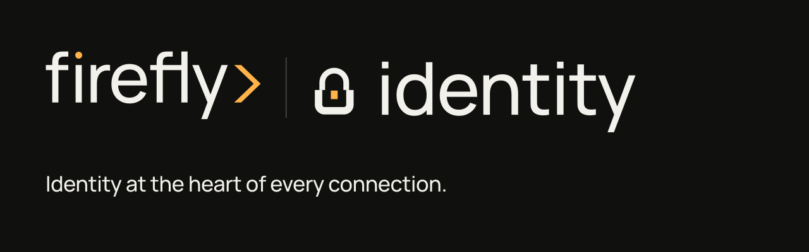
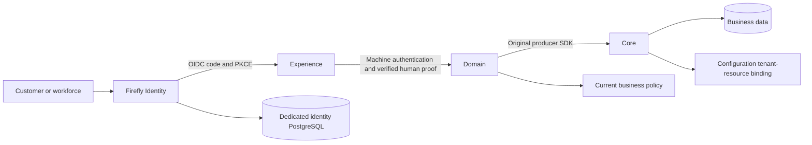

# Firefly Identity

Firefly Identity is the first-party customer identity and access management (CIAM) distribution for the Firefly ecosystem. It brings a consistent identity experience to customer, workforce, and institutional applications, with a Firefly design system and a dedicated PostgreSQL identity store.

The distribution packages Keycloak 26.8.1 through supported themes and configuration. OpenPlatform applications retain their business identities, permissions, consent, and persistence. Jafly remains an independent framework: applications integrate through its generic security ports and may select another identity provider.

**Status:** initial implementation, under qualification. Source checks and packaged artifacts are distinct from actual provider, Jafly, consumer, and production acceptance. Current evidence and remaining work are recorded in [implementation progress](docs/progress.md).

## Start with the sandbox

Requirements: Python 3.11+, Docker Compose v2, a local DNS/hosts entry for `id.firefly.test`, and at least 12 GiB free disk before pulling or starting the stack. Source checks and theme packaging need no image downloads.

```sh
make check
make theme
python3 scripts/generate.py --mode sandbox
python3 scripts/sandbox.py preflight
python3 scripts/sandbox.py pull
python3 scripts/sandbox.py up
```

Generation creates random local credentials and separate synthetic realms. It refuses to overwrite retained state. The sandbox exposes only loopback identity/mail/health ports; its dedicated database and SMTP sink remain private. Follow the [complete sandbox guide](docs/sandbox.md) for DNS, addresses, credentials, restart behavior, and stopping the owned services.

## A consistent identity experience

The Firefly theme uses self-hosted Manrope, canonical Firefly colors and isometric artwork, responsive forms, visible keyboard focus, and light/dark presentation. It extends the upstream authentication screens so server-owned credential and session mechanisms remain intact.

- Sign-in, account selection, registration, logout, and session-expiry screens.
- Password recovery, email verification, profile actions, and errors.
- Authenticator, passkey, and recovery-code setup and challenge screens.
- Account self-service, identity administration, and transactional email layout.

Inheritance supplies these flows; each enabled flow still requires runtime and visual qualification. Production self-registration, authentication strength, recovery policies, and federation are explicit deployment choices. See [theme architecture and flow coverage](docs/themes.md).

## Fit with OpenPlatform



An authenticated subject is identified by its verified issuer and opaque subject. The platform tenant namespace is preserved separately from the Configuration-owned resource tenant UUID. Server-managed party and staff links connect identities to their true business owners; they do not grant financial authority. Machine authentication does not substitute for signed human proof.

The [integration matrix](docs/integration-contract.md) records actual public source and candidate contracts, Jafly configuration, and required consumer migrations. It separates released artifacts, main branches, and open pull requests. [Architecture](docs/architecture.md) explains institution boundaries and identity lifecycle; [Jafly integration](docs/jafly.md) covers the framework-independent receiver contract.

## Documentation

| Guide | What it covers |
| --- | --- |
| [Sandbox](docs/sandbox.md) | Reproducible local setup and retained lifecycle |
| [Architecture](docs/architecture.md) | Trust boundaries, business linking, joiner/mover/leaver |
| [Integration contract](docs/integration-contract.md) | Verified ecosystem contracts and migration matrix |
| [Jafly](docs/jafly.md) | Generic resource-server integration and live-provider test |
| [Themes](docs/themes.md) | Flow coverage, packaging, accessibility, customization |
| [Security](docs/security.md) | Identity proof, protected claims, grants, proxy and secrets |
| [Operations](docs/operations.md) | Deployment, health, key/client lifecycle, backup and upgrades |
| [Troubleshooting](docs/troubleshooting.md) | Import, discovery, callbacks, mail, and theme failures |
| [Brand](docs/brand.md) | Editable identity, variants, provenance, and usage |

## Build and contribute

`make check` runs the configured source checks. `make theme` creates a deterministic `dist/firefly-id-theme.jar`, its SHA-256, and an unpacked theme directory for the sandbox. The production [Containerfile](deploy/Containerfile) consumes that artifact and pinned upstream image; production configuration is a reviewed reference, not an automated production deployment.

The hosted workflow runs source checks and an isolated provider/browser/Jafly qualification lane using synthetic identities. Its results must be read at their actual scope. Do not add production credentials, tokens, database dumps, or generated sandbox state to issues, pull requests, or artifacts.

Versions use `YY.MM.Patch`, with a numeric patch counter for the month. Firefly Identity versions are separate from upstream Keycloak and the coordinated Jafly framework release train. Software licensing and protected brand rights are described in [LICENSE](LICENSE), [NOTICE](NOTICE), and [brand usage](docs/brand.md).
