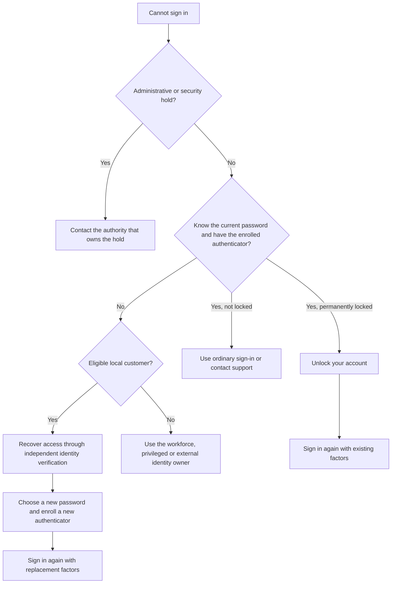

# Recover access

Choose a recovery journey according to the credentials the person still controls. An authentication lock, a forgotten password and an administrative hold require different actions.

## Choose a journey

| Situation | What the person does | Guide |
| --- | --- | --- |
| Permanently locked, with current password and enrolled authenticator available | Select **Unlock your account** and verify both existing factors | [Account locks](permanent-recovery.md), [native unlock](native-recovery.md) |
| Password or authenticator unavailable | Select **Recover access**, complete independent identity verification, then replace the password and authenticator | [Credential-loss recovery](credential-loss-recovery.md) |
| Username forgotten, registered email known | Use the email where the realm permits email sign-in; no public username lookup is provided | [Sign-in and account journeys](extended-flows.md) |
| Administrative, fraud, compliance or employment hold | Contact the owner of that restriction | [Account locks](permanent-recovery.md) |
| Support PIN needs changing | Sign in normally, then open **Customer support PIN** in account management | [Support PIN](support-pin.md) |
| Employee, administrator or externally managed identity needs lost-factor recovery | Follow the procedure of the workforce, privileged-access or external identity owner | [Supported recovery scope](credential-loss-recovery.md#requirements-and-supported-identities) |

The ordinary **Forgot password?** email flow is not an authorization to clear a permanent lock or another hold. A support PIN is not a password-reset or unlock permission.

## What customers can expect

Recovery screens give generic feedback. They do not confirm account existence, disclose the failed factor or show remaining attempts. Entering an account identifier does not sign the person in or disable an otherwise enabled account.

A successful recovery returns the person to ordinary sign-in. It does not create a customer session, restore a previous session, approve a payment or change a business relationship. Use the factors appropriate to the selected journey: existing factors after an unlock, replacement factors after credential-loss recovery.

Keep the original recovery tab open while completing an external identity-verification journey. Verification opens in another tab; return to the original tab to continue. Browser cookies, the form's current security value and the original expiry bind the request. Repeatedly opening new requests does not reset recovery limits.

## Before offering recovery

Operators must install the native extension and the corresponding owning services before exposing either entry. Known-factor unlock uses the SCA services. Credential-loss recovery uses customer KYC orchestration, Core KYCB, an approved third-party proofing adapter and a working notification channel. The theme alone supplies none of those services.

Third-party proofing is required for credential loss; no production verifier is included. Telephone or BPO verification is not implemented: only the customer's PIN lifecycle is available. See [proofing integration](assurance-provider-contract.md) and [notification operations](notification-operations.md) before enabling those capabilities.
