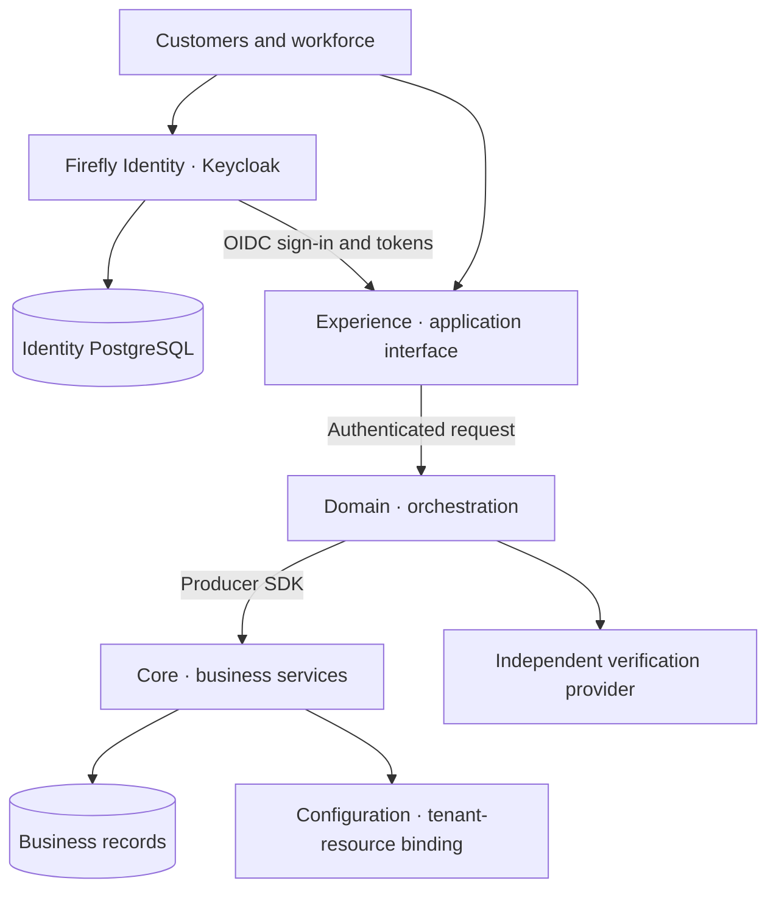

# Architecture and identity lifecycle

Firefly Identity provides a shared authentication service for customer applications, workforce tools and identity administrators. Applications use OpenID Connect to sign people in and validate their access tokens. Identity stores credentials and sessions in a dedicated PostgreSQL database; customer records, employment, consent and business permissions stay with their application owners.

## Components and responsibilities

| Component | Responsibility | Keep outside this component |
| --- | --- | --- |
| Firefly Identity | Authentication, enrolled factors, identity sessions, protected identity links and native credential operations | Banking customer records, employment decisions, consent and financial authority |
| Experience | Application interaction, session handling and orchestration of user requests | Authoritative business persistence |
| Domain | Business orchestration, provider adapters and calls through producer SDKs | A competing copy of Core's business ledger |
| Core | Authoritative business records, current business rules and operation decisions | Raw customer passwords or authenticator secrets |
| Configuration | Current mapping between an identity tenant namespace and a resource tenant | Replacing the original authenticated identity |
| Verification provider | Independent evidence under the selected assurance policy | Authorizing a native credential mutation directly from a browser callback |

Core KYCB is the KYC/KYB system of record. Customer Domain integrates independent third-party verification. A real provider must be selected and configured before documentary or biometric verification can be used; Identity does not include a biometric engine. See [the proofing provider contract](assurance-provider-contract.md).

## Separate populations and issuers

Customers, employees, institutional users and administrators have different identity policies. The sandbox demonstrates separate customer, workforce and institution realms. Each realm has its own issuer and users. The master realm is reserved for administration.

Use an exact issuer allowlist for each application. A customer token must not authenticate a staff route merely because the username, email or tenant resembles a staff identity. A realm is a logical boundary; choose separate instances and databases when the institution's isolation requirement extends to operations, storage or failure domains.

Customer MFA is optional in the generated customer profile. Fresh workforce browser authentication requires password and TOTP. Permanent administrators require a separately configured phishing-resistant MFA policy and private administration. [Authentication policies](authentication-policies.md) and [workforce administration](workforce-administration.md) explain those differences.

## Link an identity to a business actor

The stable identity key is the pair **verified issuer and opaque subject**. Do not use an email address as that key or require the subject to be a UUID.

Server-managed attributes connect an identity to its actual owner:

- `tenant_id` identifies the issuer-scoped platform namespace as an opaque string.
- `party_id` links a customer or institutional human to an authoritative party record.
- `staff_actor_id` links an employee to the authoritative staff actor.

These links identify an actor; they do not grant access to a bank account, establish a company's representative mandate or authorize a transaction. The receiving service resolves the current relationship and permission for the requested resource. Configuration's resource-tenant UUID remains a separate value from the original `tenant_id`. See [the claim reference](provider-claim-profile.md) and [service authorization](zero-trust.md).

## Provision and maintain the lifecycle

For a joiner, first create or resolve the customer/employee through its owning business API. Validate the institution, membership, onboarding requirements and consent there. An authorized provisioning adapter then creates or links the identity, writes the approved protected attributes and requests the appropriate enrollment/verification actions.

Make provisioning idempotent. Record an intent through the application's durable workflow so a failed identity call can be reconciled without creating another business person or granting broad administrator roles. The sandbox generator creates synthetic links; it is not a production onboarding connector.

For a mover, re-evaluate membership and policy before changing identity links or roles. Retire affected sessions and delegated grants as required. For a leaver or suspension, disable identity access, terminate sessions/refresh authority and withdraw business permissions through their respective owners. Where an external corporate provider owns the credential, include that provider in the lifecycle.

## Recover credentials without changing business ownership

Known-password unlock verifies an existing password and previously enrolled TOTP against a specific authentication lock. Lost-credential recovery uses a separate proofing case and one-time authority before replacing supported local customer credentials. Neither process changes party ownership, restores an employment hold or creates financial permission.

Both finish with fresh sign-in. Previously issued self-contained JWTs need receiving-service current-state enforcement when immediate revocation is required. [Choose a recovery journey](access-recovery.md) before enabling the [native protocol](native-recovery.md) or [credential-loss recovery](credential-loss-recovery.md).

## Operate the owners together

Protect and back up identity storage independently from Core-owned business/recovery stores. Forward identity and administrative events through an authenticated collector with an explicit retention and failure policy. A durable immutable-audit bridge is not included; configure the institution's audit integration rather than treating mutable identity events as immutable custody.

Use [deployment and operations](operations.md), [retained data](retained-data.md) and [observability and incidents](observability-incidents.md) for database, key, recovery and operating procedures.
