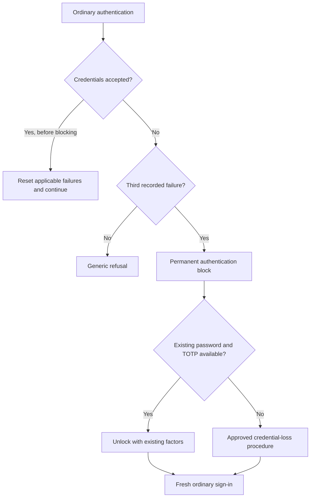

# Authentication policies

Use separate authentication policies for customers, employees, institutional users and administrators. Firefly supplies the following starting values in [the policy catalogue](../config/authentication-policies.json). Choose the factors and session behavior appropriate to each application before deploying them.

## Passwords and factors

| Population | Password length | History | Browser authentication |
| --- | --- | --- | --- |
| Customers | 16–128 characters | Previous 5 excluded | Password; MFA is optional in the sandbox |
| Workforce | 20–128 characters | Previous 10 excluded | Password and enrolled OTP on fresh authentication |
| Institutional humans | 16–128 characters | Previous 5 excluded | Password; MFA is optional in the sandbox |
| Administrators | 20–128 characters | Previous 10 excluded | Opt-in password and pre-enrolled WebAuthn key, with user verification required |

All catalogue profiles select Argon2, reject a password equal to the whole username or email, and use `passwordBlacklist(firefly-baseline.txt)`. Spaces and passphrases are supported. There is no arbitrary digit/uppercase/symbol recipe or scheduled expiry in the base policy. `notUsername` and `notEmail` compare the whole value case-insensitively, rather than excluding every substring. Enforce the maximum at the server without truncating input.

The exact policy IDs are `length`, `maxLength`, `notUsername`, `notEmail`, `passwordHistory`, `hashAlgorithm` and `passwordBlacklist`. See [Keycloak's password policy implementation](https://github.com/keycloak/keycloak/blob/26.8.1/server-spi/src/main/java/org/keycloak/models/PasswordPolicy.java).

Workforce uses `firefly-workforce-browser`: an eligible existing SSO session can be reused; fresh authentication requires both password and OTP. A user without OTP must enroll before the application receives an authorization code. TOTP uses HmacSHA1, six digits, a 30-second period, a one-step validation window and nonreusable codes. TOTP is not phishing resistant. Configure [passkeys/security keys](extended-flows.md#configure-passkeys) and stronger step-up separately where required.

The administrator catalogue alone does not install a factor flow or enroll a key. The opt-in privileged profile adds a guarded WebAuthn execution that refuses missing keys instead of offering registration during privileged sign-in. Prepare and review the candidate configuration, supervise enrollment, and qualify it on the deployed Keycloak version before activation. Separate named emergency accounts use the same password-plus-WebAuthn-UV factors. Follow the [ordered administration activation procedure](workforce-administration.md#supervise-enrollment-and-transition) to assign hardware/attestation policy, roles, RP/private ingress, enrollment/recovery authority and custody before cutover.

## Sessions and token lifetime

| Population | SSO idle | SSO maximum | Access token |
| --- | --- | --- | --- |
| Customers and institutional humans | 300 seconds | 28,800 seconds | 300 seconds |
| Workforce | 900 seconds | 28,800 seconds | 300 seconds |
| Administrators | 300 seconds | 3,600 seconds | 60 seconds |

The sandbox realm generator, `scripts/generate.py`, applies catalogue settings after its common realm values and enables refresh-token rotation with `refreshTokenMaxReuse=0`. The separate factor-profile generator, `tooling/privileged_profile.py`, inherits the source realm's password, brute-force, session, token-lifetime and rotation settings; it does not automatically apply the administrator catalogue to `master`. Approve, configure and read back those settings separately before privileged activation. Test how each application handles rotation, simultaneous refreshes, logout and reauthentication.

Identity SSO activity does not measure human inactivity in a payment application: automatic refresh can keep an identity session alive. Where the PSD2 five-minute payer-inactivity rule applies, the payment/account application must track actual payer activity and enforce its own inactivity limit.

## Blocking after three failures

The selected policy uses `bruteForceProtected=true`, `permanentLockout=true`, `failureFactor=3`, `maxTemporaryLockouts=0` and `quickLoginCheckMilliSeconds=0`. The third applicable failed authentication disables the user with `disabledReason=permanentLockout`. A successful authentication before blocking resets applicable failures.

There is no timed release. The permanent branch also bypasses failure-age reset: `maxDeltaTimeSeconds=43200` does not clear these failures after twelve hours. Retained wait values do not create a fifteen-minute unlock. See the [exact-version brute-force behavior](https://github.com/keycloak/keycloak/blob/26.8.1/services/src/main/java/org/keycloak/services/managers/DefaultBruteForceProtector.java).

Keep public errors and recovery acknowledgements generic. Do not identify the incorrect factor, reveal whether the account exists or show remaining attempts. Apply source-level abuse controls as well: permanent blocking alone can let an attacker deny access to another person.

Waiting, changing a password or deleting a failure-counter record does not unlock the account. Stock Keycloak allows a sufficiently privileged `enabled=true` update; the managed native extension vetoes generic re-enablement of tracked locks and managed attack-detection clearing. Use the dedicated [known-password unlock](native-recovery.md), or the separate [credential-loss procedure](credential-loss-recovery.md) when a factor is unavailable. Fraud, administrative and employment holds stay with their authoritative owner.

A customer needs a TOTP enrolled before the lock to use known-password unlock. The password-only customer sandbox user is not automatically eligible. Administrators use their separate privileged recovery procedure. Existing API JWTs and application sessions need receiving-service enforcement to observe a block immediately; see [zero trust](zero-trust.md).

## Maintain the password blocklist

[password-blacklist.txt](../config/password-blacklist.txt) is a small list of rejected examples, including predictable product phrases. It is not a current compromised-password dataset. Supply a maintained dataset with approved provenance, redistribution rights, integrity checks and an update owner before relying on it for that purpose.

The named file must be available at `/opt/keycloak/data/password-blacklists/firefly-baseline.txt`. Both production Containerfiles package it; the sandbox mounts it read-only. A missing file is a deployment error. The upstream provider uses case-insensitive comparison and a Bloom filter, so occasional false positives are possible. [Provider behavior and updates](https://github.com/keycloak/keycloak/blob/26.8.1/docs/documentation/server_admin/topics/authentication/password-policies.adoc).

## Change an existing realm

Startup realm import skips realms that already exist. Update retained realms through an authorized settings-level administrative change, preserve their users/factors/links/failure state and journals, and read back the effective settings. Apply the administrator profile explicitly to `master` after bootstrap; startup import does not update the bootstrapped realm. A separate overriding offline import replaces the existing realm and is not a safe substitute for the retained update. Test exact-candidate import in an empty owned database, and rehearse retained-master transition separately with a consistent backup; realm JSON alone omits runtime state. See the [candidate and transition boundaries](workforce-administration.md#prepare-an-offline-candidate).

A stronger password-creation policy does not retroactively replace existing credentials. A new factor flow also does not by itself retire bootstrap credentials, prior sessions/tokens or pending action links. Inventory and accept their retirement before reopening privileged access, using the [legacy-authority procedure](workforce-administration.md#5-rehearse-configuration-and-legacy-authority-retirement).

Before applying a change, exercise the accepted password bounds, a rejected password, workforce enrollment/challenge, the first two failures, permanent blocking and the selected recovery route in an isolated environment. Check both languages and the application session behavior. See [configuration](configuration-reference.md), [retained data](retained-data.md) and the [EU/US applicability guide](controls-matrix.md).
