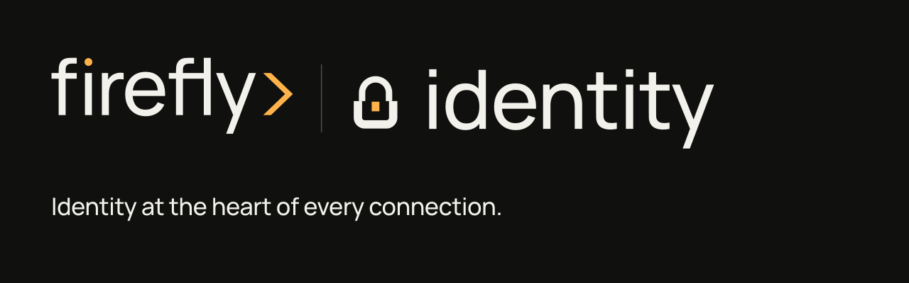

# Firefly Identity brand

Firefly Identity uses the established Firefly palette and Manrope typography, with an original protected-identity symbol and product composition. The normal visual wordmark is lowercase **firefly identity**. The family signature preserves the actual parent Firefly artwork, its spark and chevron, then adds a divider, the chosen protection emblem and lowercase `identity`. The emblem sits directly beside the product name at a matching scale.

## Assets

All brand artwork is editable vector SVG; no raster image or external font service is required.

| Asset | Purpose |
| --- | --- |
| `assets/brand/firefly-id-light.svg` | Primary signature for white or paper |
| `assets/brand/firefly-id-dark.svg` | Reversed signature for charcoal |
| `assets/brand/firefly-id-mono-black.svg` | One-color black signature |
| `assets/brand/firefly-id-mono-white.svg` | One-color white signature |
| `assets/brand/firefly-id-symbol-{light,dark,mono-black,mono-white}.svg` | Independent product identity at 16 px and above |
| `assets/brand/favicon.svg` | Identity mark on a charcoal app tile |
| `assets/brand/repository-banner.svg` | 1280 × 400 repository banner |
| `assets/brand/tokens.json` | Canonical palette and product interface roles |
| `assets/brand/fonts/manrope-latin-wght-normal.woff2` | Self-hosted variable Manrope |
| `assets/brand/index.html` | Responsive light/dark/mono identity reference |
| `assets/brand/provenance.json` | Source revisions and SHA-256 output hashes |

Open the reference locally with a static server, for example `python3 -m http.server 8766`, then visit `http://localhost:8766/assets/brand/`.

The emblem makes protected identity visible: a structural arch and broad geometric cradle enclose a single amber identity. Its balanced silhouette keeps the protection meaning clear at small sizes. The repository banner contains only the family signature with its adjacent protection emblem and **Customer identity and access management**.

## Use

Use the family signature at 160 px wide or more. Keep at least the parent wordmark's x-height clear on every side. At smaller sizes use the independent product symbol; its structural arch and geometric cradle protect a central amber identity. The favicon is designed for browser tabs and app icons. Preserve aspect ratio and supplied colors. Do not retype the Firefly parent wordmark, redraw its geometry, add effects or rearrange its components.

The canonical palette is charcoal `#10110f`, paper `#f3f1eb` and amber `#ffb34a`, with ink `#272820`, muted `#62645b`, gold `#855414`, stone `#bfb8ab`, line `#d8d4ca` and graphite `#474a42`. Use charcoal text on amber actions and gold for amber-family text on light surfaces. See [DESIGN.md](../DESIGN.md) for semantic roles and typography.

## Source provenance

The following sources were inspected on October 31, 2026:

- Private `fireflysoftwaresolutions/brand-kit` at `eb8f3fae894c517c5d39c3d4ffc07547f8e17a1b`: palette, typography, official logo rules, notice and canonical parent-logo renderer. Only necessary rendered parent-mark outputs are included. The renderer remains outside this repository.
- `fireflyframework/firefly-koinon`, current remote revision `46136fa4ddffdf5f49f54f4d51a7c75df061b312`, with local source checkout `89adfe5469a7bcb24df52a417db83db5c8b2b241`: current tokens were confirmed remotely; family divider composition, semantic theme roles and the OFL font were inspected locally.
- `fireflysoftwaresolutions/firefly-software-website`, current remote revision `795a80c1b11250630bd0e399a3c5c8763f3c9864`, with local liquidOS source checkout `82ede77203a8a6e32346ab6e77c2e117de0739bd`: current remote global styles confirm the shared charcoal/paper/amber and Manrope family. The local liquidOS surface and canonical parent-logo implementation were inspected directly.

The private kit's notice reserves its source code and marks. No blanket open-source license is inferred from it. This product's new vector protection symbol and composition are original work for Firefly. **Repository software licensing does not grant trademark rights** in the parent or product marks. Font redistribution is separately covered by the included [SIL OFL 1.1](../assets/brand/fonts/OFL.txt). See the [brand notice](../assets/brand/NOTICE.md).

The identity reference was rendered and directly inspected at 1440 px and 390 px wide, including light, dark, mono and 16–64 px symbols. Asset loading, the self-hosted font and absence of horizontal overflow were checked. This is brand-asset evidence; integrated theme and live identity-flow validation are separate.
