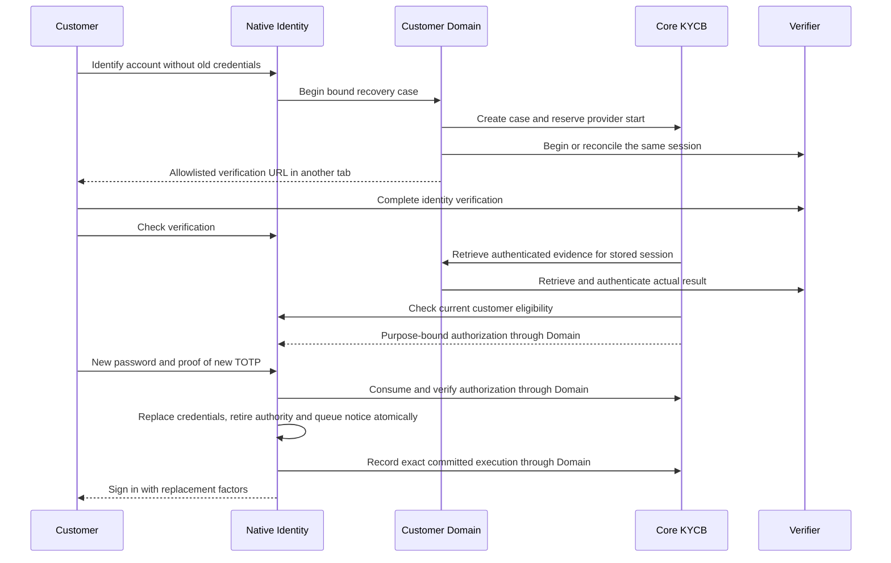

# Recover access after losing credentials

**Recover access** lets an eligible local customer replace a forgotten password or lost authenticator after independent identity verification. The previous password and old authenticator are not required. A customer who never enrolled an old TOTP can also complete this journey.

This capability requires an approved third-party proofing provider connected through the customer Domain service. No production verifier or documentary/biometric engine is included. Enable recovery only after the provider, existing-customer matching policy, notification service and operating procedure are configured and approved.

## Requirements and supported identities

The customer must have one local password, a protected tenant and canonical party reference, and a previously verified email destination. The account may be enabled or have an eligible captured permanent authentication lock. Password history, TOTP and native support PIN credentials are supported; unsupported authenticators such as passkeys are refused rather than left active after replacement.

Administrators, master identities, service accounts, workforce identities, linked external identities, foreign credential stores and administrative/security holds are excluded. Workforce and privileged recovery need their own owners. A KYC status, support PIN, email link, caller ID or staff login is not replacement authority.

For a lock with both existing factors still available, use [known-factor unlock](native-recovery.md) instead. For provider integration, see [third-party identity verification](assurance-provider-contract.md).

## Customer steps

1. Open `{issuer}/firefly-recovery/lost-credentials`, or select **Recover access** on sign-in. Enter the username, or the registered email where email sign-in is enabled.
2. Open identity verification in the separate tab. Keep the original recovery tab open. Complete the provider's required checks, then return to the original tab and select **Check verification**.
3. After approval, choose and confirm a new password. The form shows a valid configured minimum; the complete realm password and history policy is enforced on the server.
4. Add the new setup key to an authenticator using the displayed algorithm, digit count and interval. Keep the key private and enter a current code from this new account.
5. Sign in normally with the replacement password and a fresh authenticator code. The enrollment code cannot be reused immediately for sign-in.

Only fulfilled `UPDATE_PASSWORD` and `CONFIGURE_TOTP` actions are completed by replacement. Other required actions remain in effect. The previous password, old OTP credentials, support PIN authority and online/offline sessions are retired. A notice is queued to the previously verified destination.

## Services and information flow

| Participant | Responsibility |
| --- | --- |
| Native Identity | Browser security, current account eligibility, credentials, replacement, sessions and notification outbox |
| Customer Domain | Provider session orchestration and authenticated retrieval of provider results |
| Core KYCB | Durable cases, evidence references, budgets, one-time authorizations and execution records |
| Third-party verifier | The approved document, live-match, reference-identity and fraud checks |

Passwords, TOTP secrets and raw biometric/document evidence do not enter the service-to-service recovery DTOs or application tokens. The verifier's evidence must bind the existing customer, not create or link an account by name or email. Workload authentication identifies a service; it does not prove the customer's identity.

## Configure Native Identity

Install the providers, matching theme and native database objects described in [native installation](native-recovery.md#install-and-expose-the-entry). The feature is disabled unless explicitly configured. All attributes below use prefix `firefly.reproofing.`:

| Attribute | Value or purpose |
| --- | --- |
| `enabled`, `population` | Explicit `true`; population `HUMAN` |
| `issuer`, `allowed-origin` | Exact HTTPS issuer and browser origin; issuer is origin plus `/realms/{realm}` |
| `tenant` | The tenant authorized by Native Identity, Domain and Core |
| `tenant-attribute`, `link-attribute` | Protected single-valued tenant and canonical party UUID attributes |
| `ttl-seconds` | Positive original ceremony lifetime, at most 600 seconds |
| `core-workload-client-id`, `domain-workload-client-id` | Distinct confidential clients for native eligibility/journal RPC |
| `notification-workload-client-id` | Separate confidential client restricted to notification dispatch and status |
| `domain-origin`, `domain-client-id` | Trusted HTTPS Domain origin and native-to-Domain identity |
| `provider-origin` | Exact allowlisted origin for the verification journey |

Native workload clients must have standard, direct-access, implicit, service-account, device, CIBA, standard token-exchange and JWT authorization grants disabled. Mount the outbound Domain secret through `FIREFLY_REPROOFING_DOMAIN_SECRET_FILE`. Use validated TLS with no redirects or hostname-verification bypass.

TOTP policy must use nonreusable time-based codes, `HmacSHA1`, `HmacSHA256` or `HmacSHA512`, 6–8 digits, a 1–300-second period and a 0–10-step clock window. Unsupported settings refuse recovery. The browser form requires Content-Length and bounds encoded and decoded input to 16 KiB; identifiers are limited to 254 characters and passwords to 1,024 characters. Use the native forms rather than constructing a custom browser approval request.

## Configure Core and Domain

Both services use `firefly.reproofing.enabled=true` and matching `issuer`, `realm`, `tenant`, `provider-id` and `policy-id`. Keep their generic resource-server security enabled and correctly configured where the application uses it; recovery's private receiving policy does not replace unrelated endpoint protection.

| Service | Additional properties under `firefly.reproofing.` |
| --- | --- |
| Core | `receiver.client-id`, `receiver.secret-file`; `native.base-url`, `native.client-id`, `native.secret-file`; `evidence.base-url`, `evidence.client-id`, `evidence.secret-file` |
| Domain | `verification-origin`; `native-client`, `native-secret-file`; `verifier-client`, `verifier-secret-file`; `core-origin`, `core-client`, `core-secret-file`; `native-base-url`, `native-rpc-client`, `native-rpc-secret-file` |

The exact native base URL is `{issuer}/firefly-recovery/lost-credentials/rpc`; Domain's private evidence URL is its origin plus `/internal/identity-recovery/evidence`. Origins contain no embedded credentials, query or fragment. Assign separate secrets for Native-to-Domain, Domain-to-Core, Core-to-Domain evidence verification and each native RPC client. Keep every private endpoint outside browser ingress. Native RPC uses POST: Domain may call `prepare` and `admit`; Core may additionally call `journal`. Preparation checks an existing ceremony and returns its binding/expiry without asserting eligibility (`eligible=false`); only admission establishes current eligibility. The journal returns only the exact committed execution. Notification authority is separate.

Core requires its installer-owned `ops/reproofing-installer/install.sql` objects and database roles. Domain uses Core's generated SDK and owns no recovery database. Installing the native JAR registers additive JPA/Liquibase mappings even when the feature is disabled; review migration and backup requirements before startup.

## Integrator API

Set `{root}` to `/api/v1/identity-recovery/cases`. Domain and Core use these private endpoints; the browser uses Native Identity.

| Operation | Input | Result |
| --- | --- | --- |
| `POST {root}` | Native-generated immutable `binding` | Domain returns a case and optional allowlisted `verificationUrl` |
| `POST {root}/{caseId}/inspect` | Exact `binding` | Current case state |
| `POST {root}/{caseId}/confirm` | Exact `binding` | Current case and authorization when all checks pass |
| `POST {root}/{caseId}/authorizations/consume` | Binding, `authorizationId`, canonical `executionId` | Consumed authorization for that same execution |
| `POST {root}/{caseId}/authorizations/verify` | Same authorization request | Same still-live consumed authorization |
| `POST {root}/{caseId}/executions` | Binding, authorization/execution IDs, `outcome=CREDENTIALS_REPLACED` | Case updated after independent native journal verification |

A binding contains `issuer`, `realm`, `tenant`, `subject`, canonical UUID `partyId`, `population=HUMAN`, `purpose=CREDENTIAL_REPLACEMENT`, stable `generation`, complete `credentialRevision` and unpredictable `nonce`. These values come from Native Identity; callers must not derive party linkage from supplied email or name. UUIDs use canonical strings and timestamps use UTC ISO-8601. Binding strings are bounded to 512 characters and nonce to 128.

Case states are `PENDING`, `VERIFIED`, `CONSUMED`, `EXECUTED`, `DENIED` and `EXPIRED`. They are private operational information, not account-discovery responses. Core's additional provider-session operation belongs to Domain orchestration, not the browser.

## Limits, errors and retries

Cases last at most 600 seconds, bounded by the original ceremony. An authorization lasts at most 120 seconds and never beyond its case or evidence. Identical retries preserve the original case, provider-start reservation, grant, execution, expiry and budgets.

A case permits at most three authenticated rejected confirmations. A separate subject/generation budget permits at most three fully verified grant issuances across cases. Failed new-factor checks after proofing are also limited to three. Unauthenticated account claims and unavailable dependencies do not spend another person's verified-subject budget. Starting another request or restarting a service does not clear these limits.

Keep provider-pending or dependency-unavailable conditions separate from genuine authenticated negative evidence. All public feedback remains generic. Native browser transport/security refusals return HTTP 400; private RPC refusals return 403. Accepted browser submissions use 303 redirects. For an expired unexecuted request, changed contact/verification status, changed credentials/link, new hold or invalidated policy, continuation is refused; use the approved escalation procedure when needed.

After a committed replacement, reload presents completion. **Finish request** retries only pending execution recording. After expiry, an authorized service may reconcile the exact committed native journal; it cannot replace credentials again or issue another grant. Retain journals, outbox records and budgets through outages. See [notification operations](notification-operations.md) for delivery and [account locks](permanent-recovery.md) for application-session considerations.

## Protect pending enrollment and destinations

Use independent 256-bit encryption material, separate from support-PIN pepper keys:

| Mode | Settings |
| --- | --- |
| Single version | `FIREFLY_REPROOFING_ENROLLMENT_KEY_FILE`: exactly 32 raw bytes, treated as version `v1` |
| Versioned keyring | `FIREFLY_REPROOFING_KEYS_DIR`: private files named by version, each exactly 32 bytes; `FIREFLY_REPROOFING_ACTIVE_KEY`: active version |

Modes are mutually exclusive. Version names use 1–64 ASCII letters, digits, `_` or `-`. Key files must not be symlinks and must have no group/other read or write permission. For rotation, retain the original `v1` key, provision a new independent version, switch to keyring mode and activate the new version. Retained versions decrypt existing records; new encryption uses the active version. Keep old versions while their ceremonies or notices require them. Missing keys, removed versions and altered contexts refuse; there is no silent fallback or automatic data repair.

## Deployment requirements

Production use also requires approved notification delivery, source-abuse controls, retention and escalation ownership, rehearsed database rollout and deployment-specific concurrency/cluster operation. Direct SQL and custom writers that bypass managed state changes are not supported recovery administration paths.
