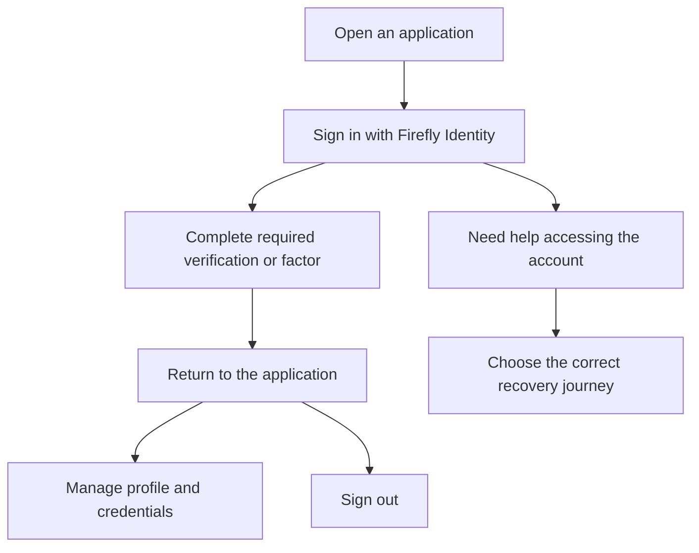

# Customer journeys

A customer usually starts in an application, uses Firefly Identity to sign in, then returns to that application. Account settings and recovery use the same identity service, but they serve different purposes.

## Sign in

1. Open the application and choose its sign-in action. The application redirects to the customer realm with its registered callback and a PKCE challenge.
2. Enter the username or registered email and password on the identity page.
3. Complete the actions required by realm policy, such as email verification or an authenticator challenge.
4. Return to the application. It validates the authorization result; its APIs validate the access token and check access to the requested resources.

The evaluation customer profile does not mandate MFA. Configure the appropriate customer factor and step-up policy before using it for a journey requiring stronger authentication. The employee profile separately requires password and TOTP. [Authentication policies](authentication-policies.md) explains these settings.

For sign-in failures, the page gives a generic response. It does not reveal whether an account exists, which factor was wrong or how many attempts remain. A permanently blocked account does not become available merely by waiting.

## Verify an email address

When email verification is required, Keycloak sends an action link to the customer's registered address. The customer opens the link, completes the confirmation and continues the original application journey. If the link has expired or has already been used, request another through the available server flow.

Verification confirms control of that communication channel. Customer identity proofing and business-account linking are separate processes. Configure the email channel, templates and expiration policy before exposing this journey. See [verification and enrollment](extended-flows.md).

## Manage the account

The Account Console presents the profile fields, credentials and sessions allowed by the realm. Customers can update permitted personal fields and manage available authenticators. Protected business references such as `tenant_id` and `party_id` are not editable customer fields.

Provision or change business links through the authoritative administrative process. Changing an email address must not move the identity to another party or tenant. Public self-registration is disabled in the supplied environment; application onboarding must use its configured provisioning process.

The optional native customer account theme also presents support-PIN management. Creating, replacing or revoking a PIN requires a fresh password and authenticator check. [Support PIN](support-pin.md) explains the steps.

## Recover access

| Customer situation | Journey |
| --- | --- |
| Knows the registered email but forgot the username | Use email at normal sign-in where enabled |
| Remembers the password and has the enrolled authenticator, but the account is blocked | [Unlock with existing factors](native-recovery.md) |
| Forgot the password, lost the authenticator or lost both | [Recover after credential loss](credential-loss-recovery.md), using independent identity verification |
| Has an administrative, fraud or compliance restriction | Contact the authority responsible for that restriction |
| Uses a corporate or external credential store | Use that credential provider's recovery procedure |

Existing-factor unlock verifies the remembered password and a previously enrolled TOTP, authorizes the current lock transition and finishes with fresh sign-in. It does not replace forgotten credentials.

Credential-loss recovery first verifies identity through the configured independent provider. The customer then chooses a new password and enrolls a new authenticator. The native transition retires superseded credentials, PIN and sessions and records a notice to the previously verified destination. Deploy the verification adapter and owning services before offering this journey.

Unknown or ineligible accounts receive generic public feedback. Support staff must not ask customers to send passwords, OTPs, authenticator setup keys, action links or tokens. See [recovery selection](access-recovery.md).

## Sign out

Use the application's sign-out action. It ends the application session and follows the configured issuer logout flow, returning only to a registered signed-out address. Applications and APIs must also apply their current-state/revocation policy to previously issued tokens.

## Language and appearance

The experience supports English and Spanish and follows the browser's supported language when no saved or explicit preference overrides it. Customers can make a discreet language choice without abandoning the current flow. Light and dark appearances use the same controls, labels and security behavior.

Use [language settings](localization.md) and [troubleshooting](troubleshooting.md) for configuration and common problems.
