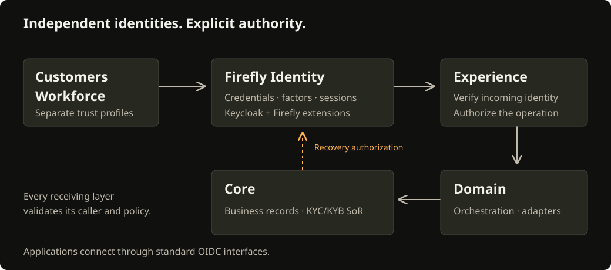

# Firefly Identity

Sign people in, protect their accounts and connect your applications through one consistent identity service.

Firefly Identity is the Firefly distribution of Keycloak for customer identity and access management. It provides branded sign-in, account management and recovery, with separate customer, employee and administration populations. Applications use OpenID Connect; identity credentials stay with the identity service, while each application controls access to its business resources.

<figure class="solution-figure">
  <picture>
    <source media="(max-width: 720px)" srcset="assets/diagrams/solution-mobile.svg">
    
  </picture>
  <figcaption>Firefly Identity manages authentication. Applications and business services authorize their own resources and operations.</figcaption>
</figure>

## Get started

If you are evaluating the product, [start a local environment](getting-started.md). The guide walks through building the theme, creating the sample realms, starting the owned services and checking sign-in and email.

If you are connecting an application, follow [Integrate an application](integration-contract.md). It explains discovery, client registration, authorization code with PKCE, access-token validation and logout. Java teams can continue with the [Jafly guide](jafly.md).

If you operate the identity service, begin with [deployment and operations](operations.md), then configure [authentication policies](authentication-policies.md), [workforce administration](workforce-administration.md) and [monitoring](observability-incidents.md).

## Understand the architecture

The [architecture guide](architecture.md) shows the components, trust boundaries and identity lifecycle. The [component overview](solution-overview.md) explains which modules you need. The [customer journeys](customer-journeys.md) follow sign-in, account management, logout and access recovery from the person's perspective.

Customer, workforce and administrative identities use separate security profiles. An authenticated identity is associated with the appropriate party or staff record through a protected link. A customer identifier, employee login or machine token does not by itself grant access to a bank account or permission to act for another person. The [security model](security.md) explains these boundaries.

## Configure the experience and security

Use the [configuration reference](configuration-reference.md) for server, realm, client and extension settings, and [default realm settings](reference/effective-defaults.md) for exact values. [Customizations](customizations.md) explains the Firefly behavior added around Keycloak.

The web experience uses Manrope, the Firefly identity, light/dark appearances and English/Spanish text. [Themes](themes.md), [language settings](localization.md) and [design tokens](design-tokens.md) explain how to customize it while preserving protocol behavior.

## Recover access

There are different journeys for a remembered password, a lost credential and an account restricted for an administrative reason. Start with [Choose an access recovery flow](access-recovery.md). It directs you to existing-factor unlock, independent identity verification or the appropriate support procedure.

Native recovery and the [support PIN](support-pin.md) are optional modules. Install and configure their backend services before selecting the corresponding theme. Lost-credential recovery also requires a trusted external verification adapter. The [recovery installation guide](native-recovery.md) and [provider integration guide](assurance-provider-contract.md) explain the prerequisites.

## Deploy and operate

Follow [regulated deployment](regulated-deployment.md) for HTTPS, private administration, database security, credentials and environment preparation. Use the [production configuration audit](production-readiness.md) to check candidate settings before deployment. [Backup and recovery](retained-data.md) covers existing databases, keys, migrations and restoration; [notification operations](notification-operations.md) covers delivery and supervision.

For regulated organizations, the [EU/US controls guide](controls-matrix.md) maps authentication and operating responsibilities to the relevant scope. Use [troubleshooting](troubleshooting.md), [frequently asked questions](faq.md) and the [glossary](glossary.md) when you need a specific answer.
