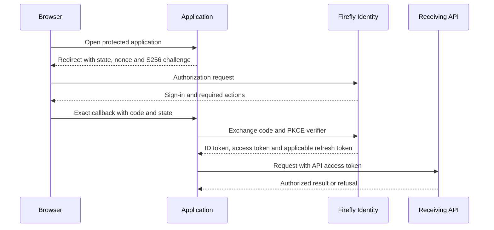

# Integrate an application

Firefly Identity accepts applications built with any framework that supports the configured OpenID Connect and OAuth 2.0 profiles. No Firefly application framework is required.

Use OpenID Connect authorization code with PKCE S256 to sign a person into an application. Use an access token for the API named in its audience, and let that API authorize the requested action. The application should not collect the person's password or turn a username lookup into authentication.

This guide uses the generated customer sandbox. Complete [sandbox setup](sandbox.md) first. Production integration uses the same protocol with the institution's configured HTTPS issuer, exact client registration, receiver audience and identity-linking policy.

## 1. Choose the client and issuer

| Setting | Public browser example | Confidential interactive backend example |
| --- | --- | --- |
| Client ID | `sandbox-web` | `sandbox-backend` |
| Customer issuer | `http://id.firefly.test:8180/realms/sandbox-customers` | Same customer issuer |
| Callback | `http://localhost:3000/oidc/callback` | `http://localhost:8081/oidc/callback` |
| Signed-out callback | `http://localhost:3000/signed-out` | `http://localhost:8081/signed-out` |
| Client secret | None; never embed a secret in browser code | Random backend credential held only on the server |
| Flow | Authorization code with PKCE S256 | Authorization code with PKCE S256 and client authentication |
| API audience | `sandbox-api` | `sandbox-api` |

The backend example is an interactive client. It is not a service account. The generated clients disable direct password, implicit, device and CIBA grants. For an unattended workload, use the separate [Configuration service-client guide](configuration-service-client.md).

For workforce integration, select the workforce issuer and workforce identity policy explicitly. Do not share a customer session as staff authentication. [Workforce administration](workforce-administration.md) explains mandatory TOTP and staff linking.

## 2. Load discovery from the trusted issuer

Configure the issuer in the application, then load its metadata:

```sh
curl --fail --silent --show-error \
  http://id.firefly.test:8180/realms/sandbox-customers/.well-known/openid-configuration
```

The response supplies `issuer`, `authorization_endpoint`, `token_endpoint`, `jwks_uri` and the supported protocol metadata. Require `issuer` to equal the configured issuer. Keep the public issuer distinct from internal routing aliases; replacing its host with an internal service name changes the identity authority.

Use a maintained OIDC client library to handle discovery, state, nonce, PKCE, token validation and logout. Configure exact callbacks and web origins; do not introduce wildcard redirects to resolve a callback mismatch.

## 3. Complete code and PKCE sign-in



At the start of each authorization attempt, the OIDC library creates unpredictable state, nonce and a PKCE verifier. It retains them in the initiating session and sends only the S256 challenge in the authorization request. Request `response_type=code` and the ordinary `openid profile email` scopes.

On callback, reject protocol errors, mismatched state and an unexpected callback path before exchanging the code. Send the same redirect URI and original verifier to the discovered token endpoint. The confidential backend also authenticates with its protected client credential; the browser client does not supply a client secret. Codes are single use.

Validate the ID token for this client, including signature, exact issuer, client audience, time and nonce. Use its subject to establish the application's identity session. Validate access tokens at the API separately. An ID token is not a substitute for the API's access token. See [token audiences](receiver-audiences.md).

Keep code, token, PKCE verifier and refresh credentials out of URLs beyond the protocol's bounded callback, application logs, browser diagnostics and support tickets. Use secure session storage appropriate to the application architecture; keep confidential credentials server-side.

## 4. Configure the receiving API

The API needs an explicit issuer, JWKS URI, approved signature algorithm and audience. It validates token signature and time before projecting a principal. Then it requires the intended population, protected tenant/link attributes and current business permission for the action/resource.

The sandbox uses RS256 and `sandbox-api`. [Claims](provider-claim-profile.md) explains their formats; [audiences](receiver-audiences.md) explains how to configure issuance and receiver validation together. Do not accept unsigned actor headers or parse a token without verifying it.

An opaque subject or tenant is not a business UUID. If a service needs a party, staff or resource-tenant UUID, resolve it through its authoritative owner while retaining the original issuer/subject/namespace. A machine token cannot supply human delegation by adding a customer identifier to the request body.

## 5. Refresh, logout and downstream calls

Use the OIDC library's supported refresh handling and update stored refresh authority atomically. Generated realms revoke refresh tokens with no reuse; concurrent refreshes must not blindly reuse an old token. Expired or refused refresh means the application needs a fresh sign-in.

Use discovered OIDC logout and an exact registered post-logout destination. Terminate the application's own session as well. Identity logout alone does not force every offline JWT decoder to reject existing tokens immediately; configure the receiving service's required current-state behavior as described in [zero trust](zero-trust.md).

Each downstream API call needs its own receiver authentication and authorization. Use that API's supported client library or protocol. Forward a human token only when it is explicitly valid for that receiver; otherwise use a supported purpose-bound exchange/delegation contract. This distribution does not configure a general human token-exchange flow. Keep that route unavailable until its owner implements it, rather than substituting client credentials for human proof.

## Optional framework example

If your application uses Jafly, the [Jafly resource-server example](jafly.md) applies these checks through its generic Spring Security module. Jafly is an independent framework that can integrate with other compatible CIAM providers; the example does not make it a component or prerequisite of Firefly Identity. Other applications implement the same protocol checks with their chosen libraries.

## Resolve common integration errors

| Symptom | Check |
| --- | --- |
| Redirect URI refused | Exact registered scheme, host, port and callback path; the token exchange must reuse it |
| Token accepted by login client but refused by API | Access token versus ID token, API audience and exact population issuer |
| Signature/JWKS failure | Trusted discovery, network/TLS access, key rotation and algorithm allowlist |
| Missing subject or tenant | Keep the `basic` client scope; configure protected attributes and required receiver projection |
| Signed staff/party link but operation denied | Current membership, resource ownership, consent, purpose and business policy |
| Old API token survives logout | Offline JWT lifetime versus the receiver's configured current-state/revocation mechanism |

Use [troubleshooting](troubleshooting.md) for server, callback and local networking issues. Never fix a refusal by disabling issuer/audience validation or granting broad identity administration.
