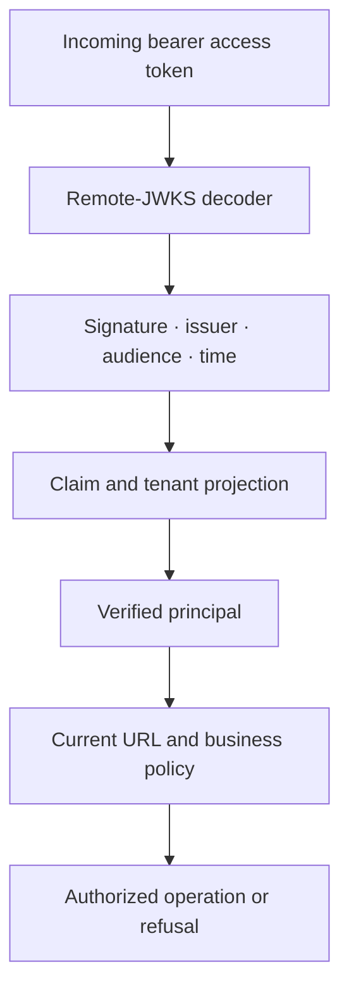

# Integrate a Jafly resource server

Jafly applications can receive Firefly Identity access tokens through the framework's generic Spring Security resource-server module. Configure the trusted issuer, remote JWKS, intended audience and principal mapping; keep business authorization in the receiving application.

Jafly remains independent of Firefly Identity. This integration does not require native recovery classes, a Keycloak administration client or a proofing-provider dependency in the framework.

## Add the resource-server module

The included [Maven example](../examples/jafly/pom.xml) uses Java 25 and the `26.10.23` Jafly release train. In a Jafly application, keep the parent and framework dependencies on the same selected train. Add the resource-server dependency to the application that receives bearer tokens:

```xml
<dependency>
    <groupId>org.fireflyframework</groupId>
    <artifactId>fireflyframework-security-resource-server</artifactId>
    <version>26.10.23</version>
</dependency>
```

The module targets reactive Spring applications. A browser-facing OIDC client has a separate sign-in/session responsibility; adding a resource-server dependency does not implement its authorization-code callback. Follow [application integration](integration-contract.md) for that side of the connection.

## Configure the trusted token profile

The following `application.yml` fragment is for the generated customer sandbox:

```yaml
firefly:
  security:
    resource-server:
      enabled: true
      issuer: http://id.firefly.test:8180/realms/sandbox-customers
      jwk-set-uri: http://id.firefly.test:8180/realms/sandbox-customers/protocol/openid-connect/certs
      audiences:
        - sandbox-api
      signature-algorithms:
        - RS256
      tenant-claim-paths:
        - tenant_id
      tenant-required: true
      role-claim-paths:
        - realm_access.roles
        - resource_access.sandbox-api.roles
      scope-claim-paths:
        - scope
      strict-policy: true
      permit-matchers: []
```

Use the deployment's exact HTTPS issuer and JWKS URI outside the isolated sandbox. `jwk-set-uri` selects external signing keys; leaving it blank selects the framework's local key path rather than the identity server. Narrow the audience to the API and the algorithm list to the approved signing profile.

Tenant projection is explicit. With `tenant-required=true`, a missing or ambiguous tenant refuses authentication. The tenant remains an opaque string; do not parse it as a UUID. Role paths select the roles this API understands, while the scope path maps the token's scope string. Neither mapping creates financial permissions.

`strict-policy=true` requires explicit policy decisions. An empty policy configuration does not grant access. Configure the application's `PolicyRule` beans or its `PolicyDecisionPort` adapter for the actual URL and business operations. In the strict URL layer, a decision with obligations is refused because that layer cannot fulfill them; enforce business obligations at an owner that can guarantee them. Keep `permit-matchers` limited to deliberately public routes.

The settings bind to the module's [ResourceServerProperties](https://github.com/fireflyframework/fireflyframework-jafly/blob/v26.10.23/modules/security-resource-server/src/main/java/org/fireflyframework/security/rs/ResourceServerProperties.java). If the application supplies its own decoder, converter or security chain, wire the same checks explicitly: the default beans defer to application-defined replacements.

## Understand the request pipeline



The decoder returns a verified Spring `Jwt`. The configured converter produces a `FireflyAuthenticationToken` containing a `SecurityPrincipal`. Application code should consume that verified principal through `SecurityContextPort`, instead of parsing the bearer or trusting an actor header.

The principal exposes `subject()`, `issuer()`, `tenantId()`, `authorities()`, `scopes()` and `claims()`. Custom `party_id`, `staff_actor_id`, `principal_kind` and `client_id` values remain claims; there are no automatic product-specific party/staff permissions. After conversion, `exp` is an `Instant`; optional `nbf` remains absent when the token does not contain it.

For example, this adapter reads the current identity for downstream application logic without returning the entire token or claims to the browser:

```java
import org.fireflyframework.security.spi.SecurityContextPort;
import reactor.core.publisher.Mono;

public final class CurrentIdentity {
    private final SecurityContextPort securityContext;

    public CurrentIdentity(SecurityContextPort securityContext) {
        this.securityContext = securityContext;
    }

    public Mono<String> subject() {
        return securityContext.currentPrincipal()
                .switchIfEmpty(Mono.error(new IllegalStateException("Authentication required")))
                .map(principal -> principal.subject());
    }
}
```

This adapter is called inside an already protected reactive request. Map missing authentication through the application's normal security error handling; it is not a controller or a replacement authorization rule. For business access, carry issuer, tenant and subject together and ask the actual resource owner to authorize the operation.

## Check deployment prerequisites

The resource server needs network and TLS trust to the configured JWKS endpoint. Resolve the public issuer consistently, allow retrieval of rotated signing keys and keep clock synchronization within the accepted token-time policy. Do not substitute a different issuer to work around a DNS or trust problem.

If the application overrides framework beans or defines another security chain, ensure each protected route uses the configured decoder, principal converter and policy manager. Keep deliberately public routes explicit. Configure the application's CSRF/session behavior for its actual browser and API flows instead of disabling controls globally to resolve a refused request.

For low-level integration, the [included decoder/converter example](../examples/jafly/src/test/java/org/fireflyframework/id/example/KeycloakJaflyContractTest.java) shows the same supported API calls. The application configuration above supplies them through auto-configuration; ordinary business code should use the verified principal port.

## Complete application authorization

A valid principal is the input to business authorization. Configure current actor eligibility, tenant/resource mapping, consent, action/resource policy and any required assurance. Do not use an unverified token parser or an identity-admin response as bearer validation.

Offline JWT verification cannot discover every subsequent lock, logout or employment change. If immediate blocking is required, add the supported current-state/introspection mechanism and its bounded cache/outage policy in each receiving application. [Zero trust](zero-trust.md) explains this boundary; [claims](provider-claim-profile.md) and [audiences](receiver-audiences.md) explain the token inputs.
