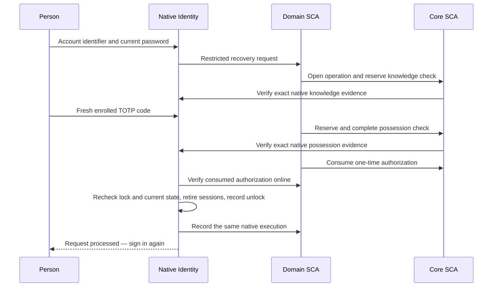

# Native known-factor unlock

**Unlock your account** restores an eligible permanent authentication lock by checking the current local password and a previously enrolled TOTP authenticator. It does not replace either credential. If one is unavailable, use the separate [credential-loss journey](credential-loss-recovery.md).

## Participants and prerequisites

| Participant | Responsibility |
| --- | --- |
| Person using the browser | Supplies the existing password and a fresh enrolled authenticator code |
| Native Identity extension | Verifies local credentials, checks the current lock and performs the native transition |
| Domain SCA | Orchestrates the operation and checks the permitted recovery boundary |
| Core SCA | Stores the operation, factor reservations, one-time authorization and execution record |

The native providers require **Keycloak 26.8.1 and Java 21**. Use both `firefly-id-native-recovery` and `firefly-id-native-domain-gateway` with the matching Firefly theme and compatible SCA services. Customer and workforce realms use separate issuers and configuration.

Eligible people are local, nonprivileged identities in an explicitly configured `HUMAN` or `STAFF` realm. The password and TOTP must already exist before the captured lock; reusable OTP codes are not supported. Master administrators, service accounts, realm administrators, foreign/federated credential stores and other holds are excluded.

## Install and expose the entry

### Build the native image

Use a build host with Python 3.11+, Node.js 22, Java 21, Maven and a container engine. Maven must be able to retrieve the dependencies declared in `extensions/pom.xml` and its two modules; the image build must be able to retrieve the pinned Keycloak image. Run from the repository root, with `dist/native` absent:

```sh
make check
python3 tooling/build_theme.py
mvn -B -ntp -f extensions/pom.xml verify
python3 tooling/package_native.py \
  --native-jar extensions/native-recovery/target/firefly-id-native-recovery-26.10.1-SNAPSHOT.jar \
  --gateway-jar extensions/native-domain-gateway/target/firefly-id-native-domain-gateway-26.10.1-SNAPSHOT.jar
docker build --file deploy/Containerfile.native --tag firefly-id-native:local .
```

The packager validates Java 21 class versions, provider registrations, database mappings and notices. It writes the two installation JARs under `dist/native/providers/` and their hashes in `dist/native/manifest.json`. The image consumes those JARs and the matching theme, then runs Keycloak's optimized build with the native brute-force provider selected.

Packaging refuses an existing output. Preserve previous packages; use a fresh build checkout for another image build, or choose a new `--output` for a separately retained package. The supplied Containerfile always reads `dist/native/providers/`. Use a unique image tag for deployment and retain its immutable digest with the package manifest.

### Install and configure

Deploy the built image using the server configuration, protected mounts and network setup in [operations](operations.md). For an existing supported Keycloak installation, use the packaged JARs as follows:

1. Install the two native provider JARs in the Keycloak provider directory with the matching theme. The [native container definition](../deploy/Containerfile.native) shows the optimized-image arrangement. Keep application-service libraries out of the provider directory.
2. Back up the native database and approve its additive JPA/Liquibase changes before starting the upgraded provider. Feature configuration does not prevent schema registration.
3. Configure the actual Domain and Core SCA services and trusted HTTPS connectivity in both directions.
4. Persist the native provider selection when building an optimized deployment, then start it with the same selection. The native container definition includes both settings:

   ```sh
   /opt/keycloak/bin/kc.sh build --spi-brute-force-protector--provider=firefly-native-recovery
   /opt/keycloak/bin/kc.sh start --optimized --spi-brute-force-protector--provider=firefly-native-recovery
   ```

   Provider selection is a build-time setting. Adding it only at optimized startup does not replace the build step.
5. Select `firefly-id-native` as the managed realm's login theme. Select that account theme only for customers using support PIN management; workforce account management uses `firefly-id`.

Use private administration, trusted certificates and protected secret mounts as described in [operations](operations.md). Production realm generation for these recovery capabilities is not supplied automatically.

## Realm configuration

All of these are server-controlled realm attributes under `firefly.native-recovery.`:

| Attribute | Configuration |
| --- | --- |
| `population` | `HUMAN` or `STAFF` |
| `issuer` | Exact public HTTPS issuer, equal to the allowed origin followed by `/realms/{realm}` |
| `allowed-origin` | Exact browser HTTPS origin, including any nondefault port |
| `client-id` | Dedicated restricted ceremony client |
| `tenant-attribute` | Protected, single-valued user attribute holding the tenant namespace |
| `link-attribute` | Protected canonical party UUID for customers, or staff actor UUID for workforce |
| `domain-audience`, `core-audience` | Distinct intended recovery receivers |
| `domain-workload-client-id`, `core-workload-client-id` | Distinct confidential private RPC clients with ordinary grants disabled |
| `domain-url` | Exact trusted HTTPS Domain origin, without credentials, query, fragment or redirects |
| `ttl-seconds` | Positive ceremony lifetime, at most 300 seconds for customers or 180 for workforce |

Make tenant and owner-link attributes administrative fields, not editable profile inputs. Each service must separately enable its native owner integration and restricted self-recovery policy. Its native RPC base is `{issuer}/firefly-recovery/rpc`. Use distinct population-specific workload credentials and mounted secrets; do not reuse an ordinary application client.

Both workload clients must be enabled and confidential, with standard authorization-code, direct-access/password, implicit, service-account/client-credentials, device, CIBA, standard token-exchange and JWT authorization grants disabled. Their credentials authenticate private RPC calls; they must not obtain ordinary OAuth tokens.

The native gateway accepts responses up to 64 KiB and bounds a request to five seconds. Configure real certificate trust and service availability; redirects and trust-all transport are unsupported.

## Complete an unlock

Open `{issuer}/firefly-recovery`, or select **Unlock your account** on sign-in. Enter the account identifier and current password, then a fresh code from the already enrolled authenticator. Unknown and ineligible identifiers receive generic presentation.



The native boundary checks the current lock generation, credentials, owner link and holds before restoration. It verifies secrets inside Keycloak; Domain and Core receive bounded evidence references rather than passwords or OTP values. The flow issues no OAuth code or token. Ordinary sign-in and applicable MFA run again afterward.

## Browser integration and retries

The native pages use a Secure, HttpOnly, SameSite=Strict cookie, rotating CSRF values, exact Origin validation and no-store responses. Use the server-rendered form and preserve its cookie. Locale selection supports English and Spanish.

Accepted form submissions return `303 See Other` to the recovery page or its `/complete` page. Reloading resumes a GET instead of resubmitting credentials. Invalid Origin, CSRF or expired live authority receives HTTP 400; other failures show generic feedback without account status or remaining attempts.

Native bootstrap, knowledge and possession budgets are each bounded to three per captured lock generation. Creating another ceremony does not reset them. HTTP retries reuse existing reservations and evidence; they do not create another verification opportunity or renew expiry.

After the native unlock commits, a lost recording response can leave execution reporting pending. The completion action retries the same record within its original authority; it does not verify factors, consume again or unlock again. If that authority expires, preserve the journal and use the approved operational reconciliation procedure. Do not clear native tables, generations or counters.

For password or authenticator loss, this page is not the correct route. Use [credential-loss recovery](credential-loss-recovery.md). Notifications for that separate replacement flow are described in [notification operations](notification-operations.md).
