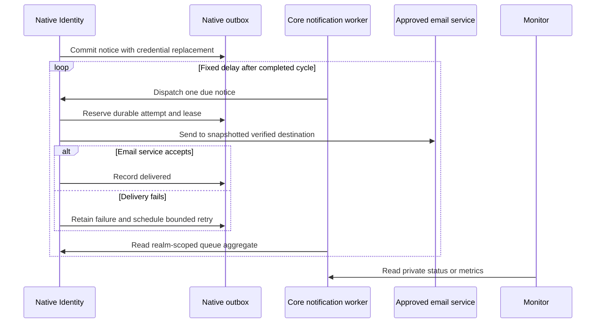

# Operate recovery notifications

Credential replacement queues a notice to the customer's previously verified destination in the same transaction as replacement. Native Identity owns the encrypted queue and delivery attempts. Core KYCB can run a managed worker that dispatches notices and publishes private aggregate health information.

Configure and verify the real email channel and assign an operations owner before enabling recovery. Browser and Domain credentials cannot supervise or dispatch the queue.

## Enable the worker

1. Configure the realm's actual Keycloak email provider and SMTP settings. Keep connect, read and write deadlines bounded; Keycloak defaults each to 10,000 ms.
2. Create a dedicated confidential Native client with ordinary token grants disabled. Set realm attribute `firefly.reproofing.notification-workload-client-id` to that client ID.
3. Configure Core's notification identity and a different read-only monitor identity using private secret files.
4. Enable both `firefly.reproofing.enabled=true` and `firefly.reproofing.notifications.enabled=true`, then restart Core with the configuration.
5. Configure external scraping/alerts and verify that a stopped worker is detected.

All properties below use prefix `firefly.reproofing.notifications.`:

| Property | Default and bounds |
| --- | --- |
| `enabled` | `false`; requires global recovery enablement too |
| `client-id`, `secret-file` | Dedicated Native notification identity and mounted credential |
| `monitor.client-id`, `monitor.secret-file` | Separate private monitor identity and mounted credential |
| `poll-interval` | `PT30S`; 1–300 seconds after the preceding cycle completes |
| `request-timeout` | `PT30S`; 1–60 seconds, bounding the complete dispatch/status cycle |
| `stale-after` | `PT90S`; greater than interval plus timeout and no more than 3,600 seconds |
| `overdue-after` | `PT2M`; 1–3,600 seconds |

Secret files must be regular nonsymlink POSIX files with owner-only read/write permissions and 32–2,048 characters. Identity IDs and secret values must differ from one another and the case/native/evidence credentials. Missing, reused or unsafe configuration refuses startup.

The worker uses `firefly.reproofing.native.base-url`, exactly `{issuer}/firefly-recovery/lost-credentials/rpc`, with Basic authentication over trusted HTTPS and no redirects. It starts a cycle immediately, then waits after completion. Disabled configuration creates no worker, notification client or private metrics registry. Shutdown cancels active and scheduled work; restart observes the same durable Native queue.

## Workload permissions and requests

Native operation paths below are relative to the configured native RPC base.

| Caller | Operation | Input/output |
| --- | --- | --- |
| Dedicated notification client | Native `POST /dispatch` | Worker sends `{"limit":1}`; response reports `processed` rows, not delivered notices |
| Dedicated notification client | Native `POST /notification-status` | Exact `{}` request; realm-scoped aggregate response |
| Independent monitor | Core `GET /internal/identity-recovery/notifications` | Worker snapshot |
| Independent monitor | Core `GET /internal/identity-recovery/notifications/metrics` | Worker-only Prometheus text |

Native dispatch also accepts an exact integer limit from 1 to 10; `{}` preserves the manual ten-row default. The notification client cannot prepare, admit or journal a recovery. Other methods/subpaths and case/browser credentials are denied. Keep these interfaces outside browser ingress.

For installations without `notification-workload-client-id`, Core's existing ceremony credential retains manual dispatch only, without notification-status fallback. Configure the dedicated identity for the managed worker; do not rely on legacy sharing.

## Read status correctly

The worker snapshot contains `state`, `activeCycle`, `lastAttemptAt`, `lastSuccessAt`, `consecutiveFailures` and `queue`. Queue is null before a successful observation. Its fields are `observedAt`, `pending`, `sending`, `retrying`, `delivered`, `failed`, `invalid`, `due` and `oldestDueDelaySeconds`.

| State | Operator action |
| --- | --- |
| `STARTING` | Wait for the initial bounded observation; investigate if it cannot complete |
| `HEALTHY` | Observation is fresh and no degradation condition is present |
| `DEGRADED` | Review retries, terminal/invalid rows or overdue work |
| `UNAVAILABLE` | Restore the failed dependency; cached queue data is not a new success |
| `STALE` | Investigate scheduling, service availability and monitoring freshness |

Counts use Native database time and include only the configured realm. They contain no customer, destination, case/execution ID, ciphertext or raw exception. Preserve original observation timestamps in dashboards. A timestamp more than 30 seconds ahead or 90 seconds behind Core is rejected; synchronize clocks. Staleness is evaluated on reads even when scheduling has stopped.

Responses are bounded to 32 KiB and require valid, exact JSON fields and counts. Malformed, duplicate or unknown values are not treated as an empty healthy queue.

## Monitor and respond

Scrape the private metrics path over HTTPS with the monitor credential in a mounted `password_file`. The `firefly.reproofing.notifications` namespace covers cycle outcomes, bounded failure categories, processing, activity, freshness and queue counts/delay. Prometheus converts dots to underscores and appends `_total` to counters. Initial unavailable queue measurements are NaN, not fabricated zeroes.

The worker registry is private and is not exported through the global composite or `/actuator/prometheus`. Use the notification alert rules supplied with Core KYCB at `ops/reproofing-notifications/alerts.yml`. Its absence alert expects scrape job `identity-core-notifications`; adapt the selector to the approved deployment topology. Check alert thresholds when changing durations. External monitoring must detect a missing or disabled worker, since the worker cannot report its own absence.

For dependency failures, check credentials, permissions, exact issuer/URL, TLS trust, connectivity, timeouts and clock synchronization. For retries or overdue work, check the approved SMTP path. Restore the dependency and allow the next cycle to observe retained state; do not log HTTP bodies, credential values or SQL bind parameters.

Delivery uses a 60-second fenced lease and at most eight attempts. Failed delivery returns to pending with bounded exponential backoff, up to one hour. An expired eighth sending lease becomes a retained failed row without a ninth send. A late worker cannot overwrite a newer delivery result.

Delivery is **at least once**: SMTP acceptance followed by an interrupted response can produce duplicate notices. Processing a row or receiving SMTP acceptance is not proof that a person read the message. Failed or invalid rows need a named review procedure. No automatic replay, delete, destination replacement or budget-reset endpoint is supplied.

Before routine shutdown, quiesce new recovery ingress and drain or review queued notices. Emergency shutdown preserves the queue for follow-up. Retain the encryption key versions needed by old destinations; see [credential-loss key rotation](credential-loss-recovery.md#protect-pending-enrollment-and-destinations).
