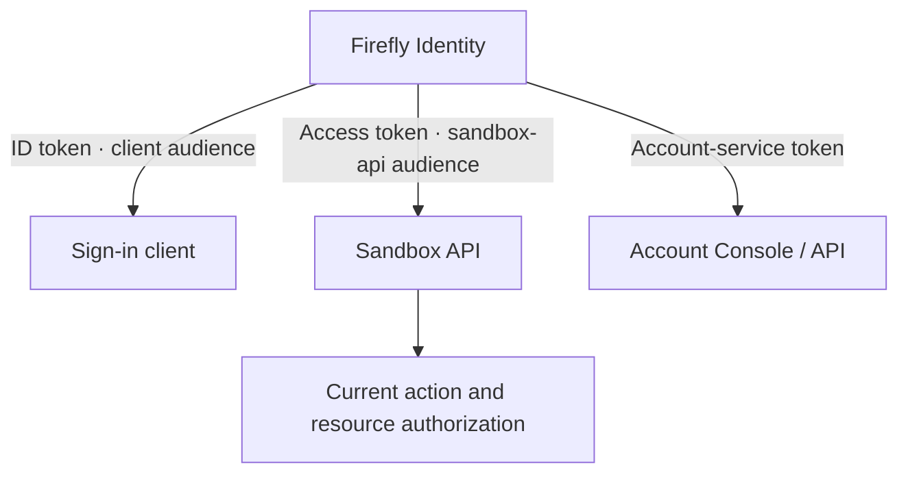

# Configure token audiences

The audience says which API may receive a token. The issuer says who issued it. Configure both: a correctly signed token from the right realm can still be intended for another service.

In the sandbox, `sandbox-web` and `sandbox-backend` obtain access tokens for `sandbox-api`. Their ID tokens identify the corresponding sign-in client. The Account Console uses its own account-service token; an application API token is not an account-management credential.

## Choose one audience contract per receiver

Record the exact issuer, API audience, approved algorithms and JWKS endpoint in the receiving service. Use a service identifier deliberately registered for that receiver; do not guess the audience from the hostname, client ID or URL of a request.

| Integration | Audience rule |
| --- | --- |
| ID token at the sign-in client | Validate the client audience and other OIDC requirements, including nonce |
| Access token at `sandbox-api` | Require `sandbox-api` in the signed `aud` value |
| Workforce API | Require its configured audience and workforce issuer; customer tokens remain invalid |
| Account self-service | Use the Account Console's own authenticated protocol/session and account-service token |
| Downstream Domain/Core | Obtain authority explicitly intended for that receiving boundary |

JWT `aud` can be a string or an array. Normalize it through the JWT library and require membership. If the application deliberately requires exactly one audience, configure the issuer to produce that stricter profile and reject incompatible tokens; do not silently strip additional audiences after issuance.

Audience membership is an admission condition, not a business permission. `aud=sandbox-api` does not grant tenant ownership, access to customer records or financial operations.

## Configure issuance and validation together

The generated interactive clients use an audience mapper with `included.custom.audience=sandbox-api` and `access.token.claim=true`. They disable full-scope access and do not place this API audience in the ID token. Their custom mappers are described in [claims](provider-claim-profile.md).

The receiver must independently require the same audience. Configure the API's JWT validation library with its exact expected audience, trusted issuer and signing-key source. [Application integration](integration-contract.md) explains these receiver checks.

Do not broaden a receiver's audience allowlist until one token works. First identify whether the application sent an ID token, an account token, a token from another population or a token issued for a different API.

## Use introspection with a dedicated receiver

The sandbox registers `sandbox-api` as a confidential introspection receiver with its own secret and all ordinary token grants disabled. It is not a service account and does not obtain machine tokens. The receiver authenticates to the issuer's `/protocol/openid-connect/token/introspect` endpoint over the deployment's trusted transport.

Keep the introspection client's credential server-side. In this distribution's Keycloak configuration, the receiver must be in the token's audience; do not bypass audience checking to introspect unrelated tokens. Decide the meaning of `active`, expiry, current user/session state and network failure in the receiving service before using introspection for immediate blocking.

Offline JWKS verification and online introspection have different availability/current-state tradeoffs. Neither authorizes a financial action by itself. [Zero trust](zero-trust.md) explains the additional current-policy decision.

## Call another API

Do not forward a token across receivers merely because services share a network. A token issued only for an Experience API does not become valid for Domain or Core. Use a supported receiver-specific token/delegation contract, preserving the original human identity separately from workload authentication.

General human token exchange is not configured by this distribution. If a downstream service needs signed human proof, implement its explicit contract before enabling that route. Client credentials identify software; adding a customer ID does not transform them into human proof.

For ordinary code/PKCE sign-in, continue with [Integrate an application](integration-contract.md). For a noninteractive caller, use [the Configuration service client](configuration-service-client.md).
