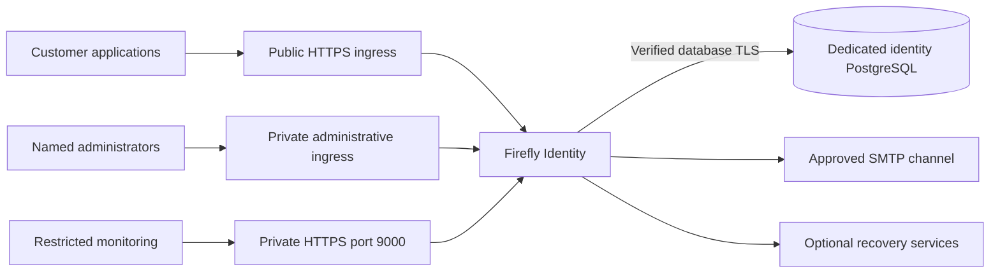

# Deploy for a regulated institution

Plan the identity service around the institution's users, applications and operating responsibilities. Firefly provides the server distribution, themes, policy defaults and optional recovery extensions. Your team supplies the production realm/client registrations, network and database environment, factor policy and operating procedures. Provision production realms through the Admin Console or authorized Admin API.

Use [EU/US applicability](controls-matrix.md) to select the obligations that apply to the legal entity and journey. Payment authentication, workforce access, privacy and ICT resilience have different scopes.

## Plan the interfaces and populations

Choose distinct customer, workforce, institutional-human and administrative profiles. Decide whether logical realms provide enough isolation or whether institutions need separate instances/databases. Record each exact issuer, audience, client, callback/logout URI and authoritative party/staff/tenant linkage.

Public ingress should allow only the required realm/protocol/account/resource routes. Deny `/admin/` and administrative-realm access there, even when `hostname-admin` is different. Private ingress and firewall rules must also prevent direct-address bypass.

## Configure the server

Build the theme image from [Containerfile](../deploy/Containerfile), or install the optional provider image using [native recovery](native-recovery.md). Retain the pinned upstream digest and scan the resulting image.

Render [keycloak.production.conf.example](../deploy/keycloak.production.conf.example) with your actual inputs:

| Input | Deployment task |
| --- | --- |
| Public/admin URLs | Create canonical HTTPS DNS names and matching certificates; keep administration private |
| Proxy addresses | Supply exact trusted CIDRs and overwrite incoming forwarded headers at ingress |
| Database URL/user | Use a dedicated database and nonsuperuser role; verify schema privileges |
| Database CA | Mount `/run/secrets/database-ca.pem`; retain peer/hostname verification without JDBC overrides |
| Server TLS | Mount certificate/key with restricted ownership; monitor expiry and rehearse rotation |
| Secrets | Inject through the secret manager or supported configuration keystore |
| Management | Route HTTPS probes/scrapes privately to port 9000 and verify the inherited certificate/name |

The reference disables HTTP, dynamic backchannel hostnames and legacy observability, and selects TLS 1.2/1.3. Preserve outgoing certificate and hostname verification. Keep database, SMTP sink, debug endpoints and monitoring off public ingress. [Configuration reference](configuration-reference.md) explains each setting.

Preserve upstream CSP/frame restrictions, referrer policy and secure cookie behavior at ingress. Configure HSTS only after reviewing the complete HTTPS hostname deployment. Native ceremony cookies use Strict SameSite; ordinary SSO/account cookies have different protocol purposes, so do not force every cookie to one blanket value.

## Establish identity and access

Before adding real users:

1. Connect the authoritative customer/staff/tenant provisioner. Never auto-link an existing identity by email or name.
2. Select customer enrollment and MFA/step-up for each covered journey. The base customer/institution sandbox profiles leave MFA optional.
3. Configure workforce authentication and the authoritative employment lifecycle. Password/TOTP alone does not provide phishing resistance.
4. Establish named least-privileged administrators with phishing-resistant factors, private access and an emergency procedure; remove temporary bootstrap accounts and secret injection.
5. Configure application receivers to validate their own issuer/audience/signature/time and current authorization, including tenant/resource binding and revocation behavior.

Login, email verification and a signed party link do not grant payment authority. Consent, mandates, risk decisions and financial permissions remain with the business service. See [security](security.md), [workforce administration](workforce-administration.md) and [zero trust](zero-trust.md).

## Enable recovery deliberately

Known-password unlock needs an already enrolled password/TOTP and the separate SCA services. Customer credential replacement needs Core KYCB, customer Domain and a configured independent proofing adapter for the existing customer. No real proofing provider is supplied. Workforce and administrator lost-factor recovery need their own credential-owner procedures.

Keep fraud/administrative/employment holds intact. Approve applicable advance notice for permanent blocking, accessible customer communications and an escalation path when proof or budgets are exhausted. Support PIN verification requires a genuine staff/customer/case authorization owner and remains unavailable without it.

Configure the real SMTP channel before enabling customer credential-loss recovery. Install the default-off notification worker and independent monitoring, then exercise SMTP outage/recovery and terminal escalation. Delivery is at least once, so a lost SMTP acknowledgement can produce a duplicate notice. [Notification operations](notification-operations.md) covers setup and day-to-day handling.

## Rehearse before opening traffic

Run the [configuration check](production-readiness.md), then verify the deployed interfaces and users: trusted TLS, public-route denial, database privileges, factor enrollment, privileged access, sign-in/logout and receiving-service permissions. Rehearse secret/key rotations and incident escalation.

Restore an isolated copy of retained data and test migration, rollback and the chosen cluster/failover topology with external delivery blocked. Include pending recovery journals and notification work. Follow [retained data](retained-data.md) and [operations](operations.md).

Assign ongoing owners for access reviews, backups, capacity, supplier changes, audit custody, privacy/retention and incident reporting. Open traffic only when those operators can execute the procedures for the actual environment.
