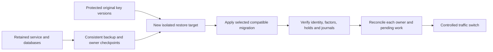

# Retained data, migration and restoration

Keep identity storage, service-owned recovery records and the keys needed to read them together. Creating a new sandbox or importing a realm does not migrate an existing system.

## Know what to preserve

| Owner | Retained material |
| --- | --- |
| Keycloak | Users, credentials, authenticators, sessions, clients, signing keys/configuration and federation links |
| Native extension | Lock generations, ceremonies, reservations/replay records, credential snapshots, execution/audit records, PIN generations and notification outbox |
| Core SCA | Known-password unlock operations, reservations and exact execution records |
| Core KYCB | KYC/KYB records, credential-loss cases, provider sessions, budgets, grants and execution/audit |
| Domain | Provider configuration and service connections; it has no separate recovery database |
| Secret/evidence owners | Signing/decryption/PIN keys, workload credentials and provider evidence/session references |

PIN lifecycle storage is native-owned. Each Core service has its own installer and roles. Keep Core business tables out of the identity database.

## Change an existing realm

`--import-realm` creates missing realms and skips existing ones. PostgreSQL initialization also applies only to a new data directory. Use supported administration/migration operations to change retained configuration, read back the result and exercise affected clients/users.

For the sandbox, retain the original state directory, ownership marker and matching database. A new generated output is a different environment. Do not overwrite ownership, import unrelated credentials or reset a factor to make an old script work.

## Install native mappings safely

The optional provider contributes thirteen JPA mappings and versioned Liquibase changes at startup. Installing its JAR can change the schema even when recovery is disabled. Enable flags govern behavior, not schema installation.

Before adding or upgrading the JAR on retained data, restore the current database to an isolated target. Check entity discovery, constraints, append-only protections, roles and ordinary identity operations with that exact build. Include existing users, holds and pending recovery records. Apply Core-owned schema changes through each service's deployment process.

## Qualify the additive support migration

The owned hosted support exercise implements a migration rehearsal over nonempty synthetic data. Its baseline JAR omits only `firefly-native-support-evidence-2` from the current Liquibase resource, retaining earlier changesets and other JAR entries unchanged. This establishes a synthetic prior schema; it is not an upgrade from a released older binary and does not establish compatibility with every historical deployment.

The exercise follows this sequence:

1. Start the synthetic prior schema and seed eleven tables: `ff_native_state`, `ff_native_ceremony`, `ff_native_attestation`, `ff_native_execution`, `ff_native_audit`, `ff_native_issued_challenge`, `ff_native_support_proof`, `ff_native_totp_replay`, `user_entity`, `credential` and `user_attribute`. Retained values include original user/credential identifiers and material, PIN generations, nonzero failures/reservations, holds, lock state, attempts and an unknown execution outcome.
2. Preserve original rows and physical column order privately, together with Liquibase identities/checksums. Start the current native build against the same PostgreSQL database and storage; do not recreate tables or rewrite prior migration history.
3. Require the actual additive changeset and nonce constraint exactly once, unchanged original-column values across all eleven tables, retained nullable legacy bindings and append-only audit protection. A legacy verified flag without complete bindings must remain insufficient for consumption, using the original unrenewed grant expiry.
4. Exercise the [native support transactions](support-pin.md#scope-of-repository-checks), then restart the service against that same database. Compare all current rows and columns, including reserved, failed and uncertain state. Reconcile the original consumed proof, grant digest, expiry and audit after simulated application receipt loss; refuse another consumption.

Inspect the workflow's `support-retained-summary` artifact for the intended source revision, migration-source digests and complete passing scenario results. Require eleven original tables preserved, unchanged historical checksums, the additive changeset/constraint applied once, append-only audit, and the same-storage and restart-preservation assertions. Bounded receipts exclude SQL snapshots, raw logs, PINs, signed contexts, tokens, exports and keys. Failure remains unresolved; preserve its original state instead of resetting counters, replacing storage, renewing a grant or replaying proof.

This exercise defines a reproducible native/database check; its implementation is not evidence of a passing run. Even a passing run does not accept an institution's retained database, historical binary, backup/key set, cross-service consistency, topology, RPO/RTO or destination applications. Rehearse those inputs separately using the restoration procedure below before switching traffic.

## Rehearse restoration

Choose the source/target, consistent recovery point, responsible operator and required keys before beginning. Block external delivery and provider submissions on the rehearsal target.

1. Coordinate writers and capture a consistent checkpoint for every affected owner. Independently timed snapshots can produce mismatched case/grant/execution state.
2. Preserve the original backup and failed-state records. Restore into a new dedicated target with compatible images/configuration and controlled access.
3. Mount historical keys under their original version names and deadlines. Restore service secrets through the secret manager; never substitute new bytes for an existing key version.
4. Prevent real mail, provider verification submissions and application traffic. An old outbox row is still a delivery intent.
5. Verify discovery/issuer, signing continuity, credentials, required factors, protected links, holds, sessions/refreshes and database privileges. Check original recovery budgets, leases and exact journal reconciliation.
6. Reconcile all owners before enabling traffic. An unknown execution stays unresolved; do not create a replacement grant, clear counters or repeat proof to repair it.

Measure recovery time and the data-loss window against your recovery-time/recovery-point objectives. A health endpoint cannot show whether the restored identities, keys and cross-service records agree.

## Retain and rotate keys

Signing keys, PIN peppers and recovery encryption keys have separate lifecycles. Retain previous encryption versions while ceremonies/outbox records require them. A file replacement is not ciphertext migration. For PIN verification, observe the approved old-key deadline and use fresh authenticated PIN replacement to move users to the active version.

Define retention and access per record purpose: identity events, banking audit, provider documents and biometric templates need different schedules. The sandbox's seven-day event expiry is not a production retention policy. Raw proofing documents and biometrics belong with their designated evidence owner, outside Keycloak attributes and application tokens.

## Roll back after a failed upgrade

If migration changed the schema, do not restart the old binary against that database. Restore the pre-change checkpoint into a compatible target with matching keys/configuration, reconcile external/application state and verify it before switching traffic. Preserve the failed-upgrade data for investigation.

For upgrade planning and backup tooling, use [operations](operations.md). For an interrupted recovery or failed notification, use [incident handling](observability-incidents.md) and [notification operations](notification-operations.md).
