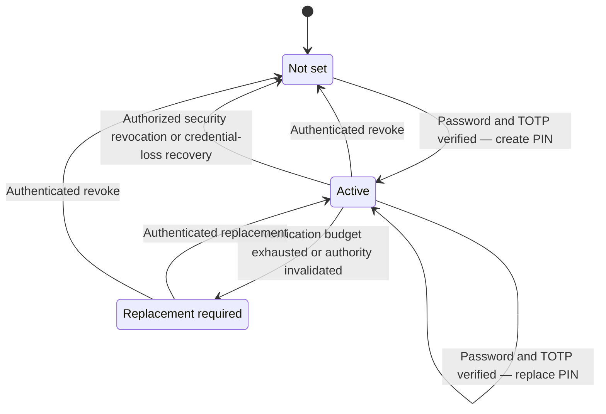

# Customer support PIN

The support PIN is a separate eight-digit customer knowledge credential. Customers can view its status, create it, replace it or revoke it in Firefly Identity. Nobody can retrieve the stored PIN.

The PIN is not an account password, card PIN, payment approval, possession factor, unlock permission or impersonation credential. Telephone and BPO verification are **not implemented**: the customer lifecycle is available, but no support platform currently provides the required verification authorization.

## Customer lifecycle

Open **Customer support PIN** in customer account management after normal online sign-in. The native route is `{issuer}/firefly-recovery/support-pin`.

| Action | What the customer supplies | Result |
| --- | --- | --- |
| View status | Active online SSO session | Not set, active or replacement required, with available lifecycle timestamps |
| Create or replace | Current password, fresh enrolled TOTP, new PIN and confirmation | New protected PIN; previous PIN authority invalidated |
| Revoke | Current password and fresh enrolled TOTP | PIN removed and revocation time recorded |

The customer must be enabled, local and nonprivileged in a configured `HUMAN` realm. Workforce and administrator identities are excluded. An offline token or surviving browser cookie without a real online session is insufficient for account/PIN navigation.

Eight digits are required. Repeated digits, repeated halves or pairs, and ascending/descending sequences are refused. Controls stay masked. Never put a PIN in notes, transcripts, recordings, a URL or a business DTO.

Mutation forms expire after 120 seconds and require the authenticated subject, Secure/HttpOnly/Strict cookie, exact Origin and one-time CSRF value. Accepted POSTs redirect with 303 to status; refreshing status does not repeat the mutation. A failed password/TOTP step-up participates in ordinary native brute-force protection.

The PIN verification budget is separate. Three failed verifications hold it without timed release; outstanding reserved checks also count against the three-slot admission limit. Replacement advances its independent generation and invalidates previous proofs. It never resets an account lock or another hold.

## Install and protect keys

Install [native Identity](native-recovery.md), select the `firefly-id-native` account theme for customers, and keep normal password/TOTP authentication available. Manage pepper keys independently of the database and credential-replacement encryption key.

| Environment setting | Required configuration |
| --- | --- |
| `FIREFLY_SUPPORT_PIN_KEYS_DIR` | Mounted directory containing version-named secret key files |
| `FIREFLY_SUPPORT_PIN_ACTIVE_KEY` | Active version: 1–64 ASCII letters, digits, `_` or `-` |
| `FIREFLY_SUPPORT_PIN_VERIFY_UNTIL_<version>` | UTC ISO-8601 expiry permitting an older version during a reviewed overlap |

Keys contain 32–4,096 bytes and must be readable by Keycloak without group/other read or write permission. Symlinked key files are refused. The native boundary applies subject/realm-bound HMAC-SHA-256 peppering followed by its Argon2 password hash provider.

To rotate, provision a new key version and activate it. Keep a bounded explicit verification overlap for the old version and require authenticated PIN replacement. Existing PINs cannot be rehashed without the customer's input. Missing or expired keys cause refusal; no unpeppered fallback exists. Back up required old keys separately and securely alongside the retained credential database.

## Security administration

An authenticated, authorized Keycloak administrator may revoke a compromised PIN through the target user's credential-management operation. This is revocation only: it cannot create or replace a PIN, clear an account lock or impersonate the customer. Generic Account REST deletion of this custom credential is refused; customers use the native step-up flow.

Administrative revocation records the actual administrator realm, subject, client and administrative event together with the native revocation. Missing attribution refuses the transaction. Login, recovery and verification budgets are preserved. Use private administrative ingress, named least-privileged identities, strong MFA and the institution's incident procedure.

## Integrating a future support channel

`NativeSupportAuthorization.Factory` is the fail-closed extension point. There is no supplied production owner implementation or public PIN-verification HTTP endpoint.

A support integration must first establish a genuine case/call, actual employee or BPO operator, employer/delegation, target customer and tenant, permitted action, current approvals and independent possession evidence. It must authenticate the requesting service and bind those facts to a short-lived, one-time authorization with replay and revocation checks.

Capture the PIN through an approved private customer input channel, not through an operator. The native verifier may return only an opaque knowledge-verification result. Every subsequent support or financial action still needs its own authorization. Caller ID, account history, a verified contact or a staff login cannot replace this owner integration. Until the channel, authorization service, recording suppression, consent and operating procedures exist, do not offer telephone or BPO verification.
