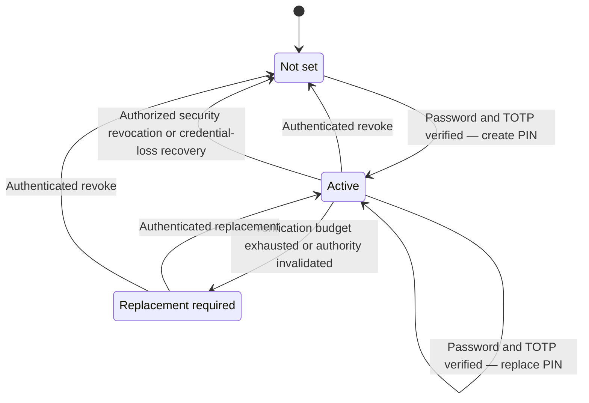

# Customer support PIN

The support PIN is a separate eight-digit customer knowledge credential. Customers can view its status, create it, replace it or revoke it in Firefly Identity. Nobody can retrieve the stored PIN.

The PIN is not an account password, card PIN, payment approval, possession factor, unlock permission or impersonation credential. Telephone and BPO verification are **not activated**. The customer lifecycle and native evidence boundary are available in source, but no support platform currently provides the required production authorization owner. The approved initial scope is consultation/support; the PIN does not grant authority for financial actions.

## Customer lifecycle

Open **Customer support PIN** in customer account management after normal online sign-in. The native route is `{issuer}/firefly-recovery/support-pin`.

| Action | What the customer supplies | Result |
| --- | --- | --- |
| View status | Active online SSO session | Not set, active or replacement required, with available lifecycle timestamps |
| Create or replace | Current password, fresh enrolled TOTP, new PIN and confirmation | New protected PIN; previous PIN authority invalidated |
| Revoke | Current password and fresh enrolled TOTP | PIN removed and revocation time recorded |

The customer must be enabled, local and nonprivileged in a configured `HUMAN` realm. Workforce and administrator identities are excluded. An offline token or surviving browser cookie without a real online session is insufficient for account/PIN navigation.

Eight digits are required. Repeated digits, repeated halves or pairs, and ascending/descending sequences are refused. Controls stay masked. Never put a PIN in notes, transcripts, recordings, a URL or a business DTO.

Mutation forms expire after 120 seconds and require the authenticated subject, Secure/HttpOnly/Strict cookie, exact Origin and one-time CSRF value. Accepted POSTs redirect with 303 to status; refreshing status does not repeat the mutation. A failed password/TOTP step-up participates in ordinary native brute-force protection.

The PIN verification budget is separate. Three failed verifications hold it without timed release; outstanding reserved checks also count against the three-slot admission limit. Replacement advances its independent generation and invalidates previous proofs. It never resets an account lock or another hold.

## Install and protect keys

Install [native Identity](native-recovery.md), select the `firefly-id-native` account theme for customers, and keep normal password/TOTP authentication available. Manage pepper keys independently of the database and credential-replacement encryption key.

| Environment setting | Required configuration |
| --- | --- |
| `FIREFLY_SUPPORT_PIN_KEYS_DIR` | Mounted directory containing version-named secret key files |
| `FIREFLY_SUPPORT_PIN_ACTIVE_KEY` | Active version: 1–64 ASCII letters, digits, `_` or `-` |
| `FIREFLY_SUPPORT_PIN_VERIFY_UNTIL_<version>` | UTC ISO-8601 expiry permitting an older version during a reviewed overlap |

Keys contain 32–4,096 bytes and must be readable by Keycloak without group/other read or write permission. Symlinked key files are refused. The native boundary applies subject/realm-bound HMAC-SHA-256 peppering followed by its Argon2 password hash provider.

To rotate, provision a new key version and activate it. Keep a bounded explicit verification overlap for the old version and require authenticated PIN replacement. Existing PINs cannot be rehashed without the customer's input. Missing or expired keys cause refusal; no unpeppered fallback exists. Back up required old keys separately and securely alongside the retained credential database.

## Security administration

An authenticated, authorized Keycloak administrator may revoke a compromised PIN through the target user's credential-management operation. This is revocation only: it cannot create or replace a PIN, clear an account lock or impersonate the customer. Generic Account REST deletion of this custom credential is refused; customers use the native step-up flow.

Administrative revocation records the actual administrator realm, subject, client and administrative event together with the native revocation. Missing attribution refuses the transaction. Login, recovery and verification budgets are preserved. Use private administrative ingress, named least-privileged identities, strong MFA and the institution's incident procedure.

## Native evidence boundary

`NativeSupportAuthorization.Factory` is the fail-closed extension point. There is no supplied production owner implementation or public PIN-verification HTTP endpoint. Exactly one installed factory must explicitly qualify itself before a native caller can use the service. An implementation that returns a plausible grant without independently checking current authorization is not a valid owner.

The contract binds these facts:

| Binding | Native requirement |
| --- | --- |
| Target | Exact configured HTTPS customer issuer and realm, local enabled nonprivileged customer subject, tenant and customer link |
| Staff | Separate HTTPS workforce issuer and actual staff subject; both issuers exclude user information, query strings and fragments |
| Owner context | Nonblank nonce, genuine case reference and call reference |
| Action and purpose | Exactly `VERIFY_SUPPORT_PIN` and `TELEPHONE_SUPPORT_KNOWLEDGE` |
| Lifetime | Future expiry with at most 120 seconds remaining at admission; a recheck must preserve the exact original expiry |
| Field bounds | Customer subject: 128 characters; action/purpose: 64; other string fields: 512. Blank, surrounding whitespace and control characters are refused |

The native service reserves one of three per-generation check slots before checking the PIN. The database enforces a unique digest of the configured target realm ID, issuer and nonce. Changing the subject, tenant, case, staff identity or expiry cannot turn the same nonce into another attempt. A separate digest binds the complete exact grant. The service checks current owner authorization again outside database locks before it performs the reserved check.

Proof state progresses from `RESERVED` to `REJECTED` or `VERIFIED`, then from `VERIFIED` to `CONSUMED` at most once. A bad PIN consumes its reservation and increments the failed-check counter. Three failed checks hold the PIN without a timer. An owner outage, changed authorization, unavailable pepper/hash provider or expired request leaves the reservation unavailable; it does not refund a slot or count as a bad PIN. Three pending reservations therefore also prevent admission. Authenticated PIN replacement creates a new generation; it does not revive evidence from the old generation.

`NativeSupportPinServiceImpl.consume(signedSupportContext, reference)` is native-only. It reauthorizes the caller through the same owner before acquiring native locks, then locks the customer, state and proof in that order. It requires the exact original grant, current customer and credential eligibility, original PIN generation, credential and pepper-key version, unexpired proof, enabled account and absence of account/PIN holds. Expiry is checked after acquiring locks. Consumption and its audit record commit in the same native transaction; consumption does not issue a customer token or authorize any business operation.

Each transition appends the proof reference, full-grant and nonce digests, actual staff issuer/subject, case/call, tenant/customer, action/purpose and PIN generation to the native audit journal. PostgreSQL's existing append-only audit trigger protects those records. PINs, signed contexts, raw tokens and provider payloads are not audit fields. Restrict access to the journal because its attribution still identifies people and cases.

The additive migration preserves historical proof rows. New binding/status columns remain nullable for those retained rows; a legacy `verified` flag alone cannot make a proof consumable. Preserve the proof table and audit journal together. Never delete nonce records, reset attempt counters or create replacement authorization to resolve an uncertain result.

If verification or consumption commits but its response is lost, the caller must reconcile the original reference with the owner and native journal. Repeating verification or consumption is refused, including a consumed reference. Receipt loss is an unknown result until reconciliation; it is not permission to ask for another PIN or mint a replacement nonce.

A support integration must first establish a genuine case/call, actual employee or BPO operator, employer/delegation, target customer and tenant, permitted action, current approvals and independent possession evidence. It must authenticate the requesting service and bind those facts to a short-lived, one-time authorization with replay and revocation checks.

Capture the PIN through an approved private customer input channel, not through an operator. The native verifier may return only an opaque knowledge-verification result. Every subsequent support or financial action still needs its own authorization. Caller ID, account history, a verified contact or a staff login cannot replace this owner integration. Until the channel, authorization service, recording suppression, consent and operating procedures exist, do not offer telephone or BPO verification.

## Activation and acceptance

The approved initial use is consultation/support only. The institution has not yet selected the genuine case/authorization owner or its protocol, and this distribution supplies neither a production factory nor a public verification route. Complete the steps below in order before offering telephone or BPO verification. Keep the decisions and evidence in the institution's controlled [decision record](production-decisions.md#maintain-one-decision-record).

### 1. Assign the owner and define the permitted consultation

The customer-service owner appoints the team and service accountable for genuine cases and current authorization. Workforce security and outsourcing management establish who may act for each provider and tenant. Name the approver, implementation owner, operating contact and outage escalation; a team name without an operating service is not a completed integration.

Record the customer and workforce issuers, customer-link source, staff/employment source, provider/delegation identifiers, tenant mapping, genuine case/call source, and the exact read operations and resources allowed. Include the approval rule, revocation source and maximum permitted authorization staleness for each operation. Leave account changes, payments, impersonation and customer-token handoff outside this scope. The native `VERIFY_SUPPORT_PIN` action only checks knowledge; the receiving application must independently authorize the selected consultation operation.

### 2. Select customer evidence and the private input channel

The customer-service and security owners select an independent possession check and a private customer PIN-entry channel. Record how possession is established, its freshness limit, its binding to the same customer and call, and how its result reaches the authorization owner. Possession must be independently verified; the PIN, caller ID, staff sign-in or account history cannot stand in for it. A PIN check alone is not MFA, and adding another knowledge question does not provide a possession factor.

The channel owner records the customer interaction, service authentication, transport protection, recording/transcription suppression, screen/access restrictions, permitted telemetry and failure behavior. Privacy and operations owners review the customer notice and applicable consent procedure. Demonstrate that the operator, recordings, transcripts, analytics and error logs cannot receive the PIN. If the selected channel cannot preserve that boundary, keep verification unavailable.

### 3. Implement and qualify the authorization owner

The integration owner implements exactly one qualifying `NativeSupportAuthorization.Factory` and the private caller integration. This is development and deployment work; completing this checklist does not provide a production factory or create an HTTP endpoint. Authenticate the requesting service and actual operator, and check current employment, delegation, case, customer, tenant, approvals and possession evidence before admitting a check.

Record the protocol/version, authenticated caller identities, signing/key custody and rotation, allowed receivers, expiry and revocation checks, outage behavior and reconciliation contact. The native grant must contain the exact `nonce`, `targetIssuer`, `realm`, `subject`, `tenant`, `customerLink`, `staffIssuer`, `staffSubject`, `caseId`, `callId`, `permittedAction`, `purpose` and `expiresAt` described above. Employer/delegation, possession and approval evidence remain the owner's responsibility; inventing extra native grant fields does not enforce them. The original grant must survive reauthorization unchanged, with at most 120 seconds remaining at admission. An unavailable owner or indeterminate authorization must refuse.

The service returns an opaque reference to scoped knowledge evidence. The authorized consumer must use native one-time consumption and receive a committed result before relying on that evidence. Each consultation receiver still checks current permission for its own resource. Do not turn a successful PIN result into a customer session or a general support entitlement.

### 4. Prepare operations and reconcile uncertain outcomes

The security and service-operations owners assign pepper-key custody, native journal access, case/audit correlation, incident response and approved retention. Record the evidence-reference lookup procedure, responsible reconciliation team, response deadline and behavior while the outcome is unknown. Keep PINs, signed contexts, tokens and raw provider payloads out of those records.

Rehearse a lost response after verification and after consumption. Reconcile the original reference with the owner and journal; do not repeat proof, mint a new nonce, refund a reserved slot or reset counters. If the journal cannot establish the result, suspend the dependent consultation. Preserve the original proof, case, grant identity, generation, attempts and audit so the uncertainty can be resolved.

### 5. Run acceptance before enabling the selected scope

The integration, security and receiving-application owners run these exercises against the complete candidate in an isolated environment with representative retained state. Record the deployed versions/configuration, scenario, expected result, observed result, timestamp, evidence location and accepting owner. Never include the supplied PIN or authorization secret in acceptance evidence.

| Exercise | Required observation |
| --- | --- |
| Eligible consultation | The actual operator and service, genuine case/call, current delegation, independent possession and correct PIN produce one consumable knowledge result; only the approved read operation succeeds |
| Missing authority | Missing case, approval or possession; revoked employment/delegation; wrong customer, tenant, issuer or purpose; and owner outage all refuse without business access |
| Replay and expiry | Reused nonce, altered grant, expired context/proof and a second consumption refuse; reauthorization cannot extend the original expiry |
| Attempt and concurrency limits | Same-nonce attempts across customers cannot create multiple reservations; concurrent different-nonce attempts respect three slots; bad PINs and pending reservations enforce the documented budget |
| State changes and races | PIN replacement/revocation, account or PIN hold, credential change and expiry during lock acquisition prevent consumption; concurrent consumers produce at most one committed consumption |
| Persistence and interruption | Retained legacy rows remain nonconsumable without complete bindings; audit failure rolls back consumption; restart and response loss preserve original state and support reconciliation |
| Channel and permission separation | Operators and recording/logging systems cannot capture the PIN; PIN evidence cannot unlock an account, replace credentials, impersonate a customer or authorize a financial action |

### 6. Approve activation and define when to stop

The customer-service owner approves only the recorded consultation scope after security, integration, channel and receiver owners accept their results and operations can reconcile failures. Record the exact deployment, enabled providers/tenants/operations, activation time, approver, monitoring limits and stop authority. An isolated source or database test is supporting evidence; it does not accept the actual owner, private channel or destination receivers.

Keep verification disabled while any required owner, dependency or result is unresolved. During operation, suspend new verification and dependent consultations if authorization, possession, private input protection, audit integrity or reconciliation cannot be established. Preserve logs and retained proof/budget state, isolate the affected integration and use its incident owner. Resume only after the failed gate has been reaccepted; do not reopen by deleting nonce history, replaying consumption or creating replacement authority. Support PIN evidence never substitutes for forgotten-password recovery, lost-authenticator recovery, payment approval or customer impersonation.

### Scope of repository checks

Source regression tests cover grant constraints, altered-grant replay identity, reservation budgets, owner refusal/outage, one-time consumption, lock order, audit attribution, expiry and credential/hold invalidation. These tests and the additive migration require actual native compilation and PostgreSQL execution in owned hosted qualification. The native image workflow includes a hosted-only storage probe for cross-customer nonce contention, nullable legacy bindings, proof/audit rollback and append-only attribution on its fresh, empty PostgreSQL database. That probe does not exercise the native service or upgrade retained data. In particular, qualify concurrent same-nonce attempts across different customers, concurrent different-nonce budget exhaustion, consume races, rollback after audit failure, migration over retained legacy rows and response-loss reconciliation. Mocked transaction tests do not prove database uniqueness, atomic commit or concurrency behavior. Production activation remains blocked until the genuine owner and complete channel pass acceptance.
