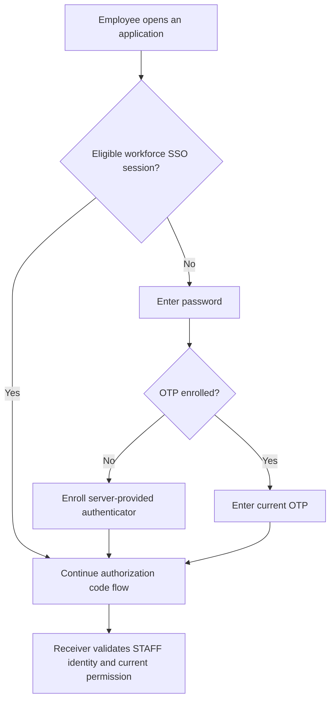

# Workforce and administration

Workforce sign-in identifies an employee. Administration controls the identity service. Acting for a customer requires a separate business permission; neither an employee session nor an administrator role supplies it automatically.

## Configure workforce sign-in

Keep workforce in its own realm, clients and user store, with a server-managed `staff_actor_id` from the employment owner. The sandbox uses `sandbox-workforce` and `firefly-workforce-browser`.

Fresh authentication requires password and OTP. Initial enrollment is a server required action completed before code issuance. An eligible existing SSO session may be reused; the employee is not asked for a new OTP on every navigation. TOTP is not phishing resistant, so select a stronger flow for access that requires it. [Passkey setup](extended-flows.md#configure-passkeys) describes the separate passwordless configuration.

To check a workforce application, complete sign-in/enrollment, then use a fresh browser context and verify that a wrong OTP cannot finish the callback. Confirm that the valid token has the workforce issuer, `principal_kind=STAFF` and the correct staff link. Customer tokens must be refused by workforce receivers. [Authentication policies](authentication-policies.md) lists the settings.

## Manage joiners, movers and leavers

| Event | Identity task | Employment/application task |
| --- | --- | --- |
| Joiner | Provision/link through the authorized service and enroll authenticators | Establish employment, tenant membership and staff actor |
| Mover | Apply authorized link/policy changes and retire affected sessions | Re-evaluate roles, institution membership and delegation |
| Leaver or suspension | Disable access, retire sessions/refresh credentials and handle federation access | End employment/business/delegation grants and preserve required records |
| Credential loss | Use the workforce credential owner's recovery procedure | Recheck employment/security eligibility and approvals |

Never link an employee or customer by email/name alone. Where a corporate IdP owns credentials, its enrollment and recovery procedure remains authoritative. The customer credential-loss extension does not replace lost employee factors.

## Unlock a local employee account

The optional native unlock supports configured local `STAFF` identities that still have the current password and a TOTP enrolled before blocking. Workforce and customer issuers, links, clients and budgets remain separate. Master administrators, privileged realm administrators, service accounts and foreign credential stores are excluded.

Core/Domain SCA authorize only the current authentication lock. An employment, fraud or administrative hold cannot be removed through self-service. The employee signs in normally after unlock. See [native recovery](native-recovery.md).

## Establish permanent administration

Use private administrative ingress and named least-privileged accounts in the administrative plane. Configure phishing-resistant MFA, an emergency-access procedure, access reviews and attributed audit. The catalogue's `mfaRequired` field does not build that flow or enroll its users.

1. Use the supported temporary bootstrap process to establish the initial administrator.
2. Create permanent named administrators with only their required roles.
3. Enroll their factors and verify ordinary, privileged and emergency access.
4. Remove temporary bootstrap accounts and secret injection; verify that the former temporary access is refused.
5. Deny public `/admin/` and administrative-realm routes, and prevent direct service bypass.

The sandbox account `sandbox-bootstrap` is for local evaluation only. A separate `hostname-admin` does not enforce route privacy; configure it at ingress. [Deployment setup](regulated-deployment.md) explains network and TLS requirements.

## Support staff acting for a customer

A support action needs current authority binding the real operator, customer, tenant, case/call, action/resource, purpose, expiry and any approvals. Preserve employee attribution throughout Domain/Core calls. Viewing information and initiating a payment are different permissions.

A customer PIN check provides only scoped knowledge evidence. The support/BPO case authorization owner is not supplied, so support verification remains unavailable until it is integrated. Do not impersonate the customer, hand an employee their refresh token or treat a service credential as customer proof. Follow [support PIN](support-pin.md) and [zero trust](zero-trust.md).

## Make administrative changes carefully

Password replacement does not unlock a permanent block. Failure-counter clearing is not a recovery procedure. The managed native extension vetoes generic re-enablement of tracked locks; use the bound recovery operation. Privileged PIN revocation follows its separate permission and real administrator attribution.

Disabling a user or retiring sessions also requires application-side revocation/current-state handling for already issued JWTs. For interrupted recovery, preserve the original journal and budgets. Use [incident handling](observability-incidents.md) rather than clearing state to force a retry.
