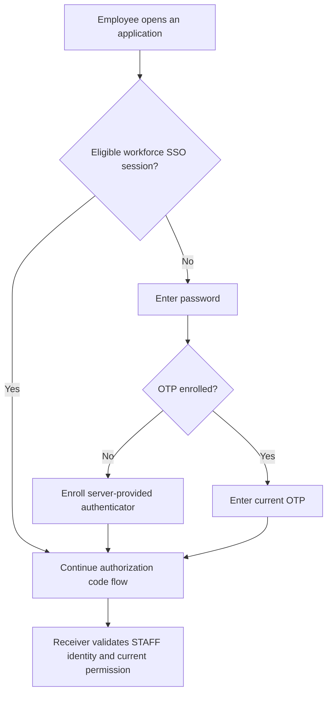

# Workforce and administration

Workforce sign-in identifies an employee. Administration controls the identity service. Acting for a customer requires a separate business permission; neither an employee session nor an administrator role supplies it automatically.

## Configure workforce sign-in

Keep workforce in its own realm, clients and user store, with a server-managed `staff_actor_id` from the employment owner. The sandbox uses `sandbox-workforce` and `firefly-workforce-browser`.



Fresh authentication requires password and OTP. Initial enrollment is a server required action completed before code issuance. An eligible existing SSO session may be reused; the employee is not asked for a new OTP on every navigation. TOTP is not phishing resistant, so select a stronger flow for access that requires it. [Passkey setup](extended-flows.md#configure-passkeys) describes the separate passwordless configuration.

To check a workforce application, complete sign-in/enrollment, then use a fresh browser context and verify that a wrong OTP cannot finish the callback. Confirm that the valid token has the workforce issuer, `principal_kind=STAFF` and the correct staff link. Customer tokens must be refused by workforce receivers. [Authentication policies](authentication-policies.md) lists the settings.

## Manage joiners, movers and leavers

| Event | Identity task | Employment/application task |
| --- | --- | --- |
| Joiner | Provision/link through the authorized service and enroll authenticators | Establish employment, tenant membership and staff actor |
| Mover | Apply authorized link/policy changes and retire affected sessions | Re-evaluate roles, institution membership and delegation |
| Leaver or suspension | Disable access, retire sessions/refresh credentials and handle federation access | End employment/business/delegation grants and preserve required records |
| Credential loss | Use the workforce credential owner's recovery procedure | Recheck employment/security eligibility and approvals |

Never link an employee or customer by email/name alone. Where a corporate IdP owns credentials, its enrollment and recovery procedure remains authoritative. The customer credential-loss extension does not replace lost employee factors.

## Unlock a local employee account

The optional native unlock supports configured local `STAFF` identities that still have the current password and a TOTP enrolled before blocking. Workforce and customer issuers, links, clients and budgets remain separate. Master administrators, privileged realm administrators, service accounts and foreign credential stores are excluded.

Core/Domain SCA authorize only the current authentication lock. An employment, fraud or administrative hold cannot be removed through self-service. The employee signs in normally after unlock. See [native recovery](native-recovery.md).

## Establish permanent administration

Use private administrative ingress and named least-privileged accounts in the administrative plane. The approved baseline is **password followed by an already enrolled FIDO2/WebAuthn credential with user verification required**. A passwordless credential, TOTP, recovery code, SSO cookie or corporate sign-in is not an alternate factor for this profile. The catalogue's `mfaRequired` field does not build the flow, enroll accounts or grant administrative roles.

The optional `firefly-privileged-webauthn` provider ships in the native extension and targets **Keycloak 26.8.1**. Install the version-matched provider before testing a candidate. It checks the account and policy when creating a challenge and again when processing the assertion. Admission requires a currently enabled, named local nonservice account, verified email, password evidence in the current authentication session, an existing `webauthn` credential, no outstanding user required actions, and the required user-verification policy. `webauthn-passwordless` does not satisfy the second-factor check. Keycloak performs the challenge, origin, RP ID, signature and user-verification validation.

A required upstream WebAuthn execution can initiate registration when a credential is missing; see the [pinned WebAuthn authenticator](https://github.com/keycloak/keycloak/blob/26.8.1/services/src/main/java/org/keycloak/authentication/authenticators/browser/WebAuthnAuthenticator.java). This provider always routes the execution through its own guard, never schedules registration, and refuses a missing or deleted credential on either request stage. The factory permits only a required execution and disallows user setup. These are credential controls; Keycloak's actual realm and client roles still decide which Admin REST operations the named administrator may perform.

### Prepare an offline candidate

`tooling/privileged_profile.py` prepares and validates an offline realm document. It never authenticates to Keycloak, activates a profile, creates an account, changes a client or grants a role. An explicit `--realm master --acknowledge-master` supports preparation for actual master administration. Applying the profile only to a different realm does not protect master or give that realm control of other realms.

Start with a protected, complete realm export for configuration analysis and a reviewed working copy. Exports may contain password hashes, WebAuthn material and client secrets; keep them outside source control with restricted custody. A partial Admin REST realm response without its complete client and pre-enrolled user inventory is insufficient. The tool's credential-type check establishes that the input describes enrollment; it cannot verify possession or establish the truth of an edited export. A realm JSON export is not a complete backup: Keycloak exports omit events, persisted sessions, workflow state and revoked tokens. Preserve a separate consistent database, configuration and key checkpoint using the [retained-data procedure](retained-data.md). See [Keycloak import/export limitations](https://www.keycloak.org/server/importExport).

Prepare these prerequisites explicitly in the working copy, using institution-approved configuration decisions:

- Keep email verification and TLS-only access enabled. Every enabled administrator must already have a permanent password, verified email and a registered two-factor `webauthn` credential, with no pending required actions. Resolve temporary bootstrap accounts before the final candidate.
- Inventory every client. Keep `security-admin-console` as the sole interactive OIDC client with authorization code flow, PKCE `S256`, the exact admin origin and the console redirect path. Disable interactive `account`, `account-console`, `admin-cli` and `broker` access. Preserve the built-in role-resource clients as noninteractive resources. Keycloak refuses configuration updates to `realm-management` outside master and to master's internal `*-realm` resources. Their `bearerOnly=true` setting prevents authorization and token issuance even when the inherited `standardFlowEnabled` flag is true; do not try to disable these protected role containers through a client update. The offline validator accepts that inert flag only for a matching internal identifier with the server-exported `realm_client=true` attribute and exported `view-realm`/`manage-realm` roles; all other client safeguards still apply. Do not remove existing role mappings.
- Explicitly disable direct password grants, implicit flow, service accounts, device authorization, CIBA and token exchange. Remove offline access from client scopes. Client-specific authentication-flow overrides are refused, including apparently equivalent overrides. The generator does not repair clients for you.
- Keep only supported native local providers and reviewed built-in flows/configuration. Custom providers, custom client attributes, federation, broker configuration, custom required actions and unsupported realm attributes are refused. Unknown audit listeners are refused instead of removed; the known `jboss-logging` and native invalidation listeners are preserved. Integrating an institution's additional collector requires a reviewed extension to the allowlist and tests.

For separate identity and administrative hosts:

```sh
python3 tooling/privileged_profile.py generate \
  --input /protected/reviewed-master-export.json \
  --output /protected/master-privileged-candidate.json \
  --realm master --acknowledge-master \
  --origin https://identity.example.com \
  --admin-origin https://identity-admin.example.com

python3 tooling/privileged_profile.py validate \
  --input /protected/master-privileged-candidate.json \
  --realm master \
  --origin https://identity.example.com \
  --admin-origin https://identity-admin.example.com
```

`--origin` is the browser authentication origin and determines the RP ID. `--admin-origin` is the console origin; it defaults to `--origin`. Both require canonical HTTPS origins without paths. The current tool deliberately refuses unsupported extensions and deployment shapes instead of guessing. Its output is created exclusively with owner-only permissions; it refuses an existing output path and never prints the realm contents.

The candidate preserves users, roles, client configuration, supported audit listeners and known built-in flow definitions. It retains the reviewed native client-registration policy components with their original identifiers and exact configurations; custom policies require separate review. These policies restrict client registration and are separate from the disabled end-user registration flow. It adds a required password execution followed by the guarded WebAuthn execution and binds browser authentication to that exact sequence. Registration, reset, direct grant, Docker and first-broker bindings point to a deny flow; automatic passkeys on the password form, all supported required actions and self-service enrollment are disabled. There is no cookie, OTP, broker or optional execution in the privileged browser flow. Existing client-authentication definitions remain available for protocol handling; no client is allowed a service-account or alternate administrative grant.

Password, brute-force, session, token-lifetime, refresh-token rotation and audit-retention settings are inherited from the reviewed source realm. Approve and test those settings before activation; the factor-profile generator does not automatically apply the administrator policy catalogue to `master`. A fresh upstream `master` is therefore not a complete production baseline merely because this generator accepts its factor profile. The synthetic rehearsal's extended access-token lifetime exists only to measure retirement of still-valid authority.

Validation checks the complete supported candidate, all client inventories and overrides, flow order and requirements, registration/reset bindings, required actions, user prerequisites and user-verification policy. It is an offline configuration check. It does not prove that the server loaded the provider, that an import preserved the candidate, that roles are appropriate, or that no earlier token or action link remains usable.

Exact candidate import and retained-master transition are different exercises. Test import compatibility in an empty, owned database. For an existing master realm, use a reviewed settings-level update that preserves accounts, credentials, role mappings, journals and other retained state, then read back the effective configuration. Do not use an overriding realm import as that update: [Keycloak 26.8.1's import implementation](https://github.com/keycloak/keycloak/blob/26.8.1/model/storage-services/src/main/java/org/keycloak/exportimport/util/ImportUtils.java) removes the existing realm before importing its replacement. Successful import into an empty fixture does not prove preservation of a retained deployment.

### Supervise enrollment and transition

Enrollment is a separate, controlled preactivation operation. A person who knows only an administrator password must never be allowed to use the privileged sign-in flow to enroll or replace its second factor.

Complete the following steps in order. The approved factor baseline is already selected; the named owners must resolve its deployment choices and record acceptance for the actual destination. Keep account identifiers, device inventories and evidence in a protected [institution decision record](production-decisions.md#maintain-one-decision-record).

Use the [recommended first activation proposal](production-decisions.md#recommended-first-activation-proposal) and its stable `ADMIN_*` choices as the starting record for hardware, roles, ingress, enrollment, emergency custody and operating objectives. The institution must select and accept each choice before opening real access.

#### 1. Approve hardware and administrative roles

The privileged-access and security owners select physical authenticators, supported browsers/platforms, spare-key policy and attestation requirements. Record device model/inventory references, permitted algorithms, authenticator attachment and resident-key choices, acceptable AAGUIDs if used, attestation trust/validation procedure, and replacement criteria. The profile fixes user verification to `required`; it does not select a hardware supplier or establish hardware provenance. An attestation preference alone is not evidence that a device meets the institution's policy. Qualify the actual enrollment policy and devices, including how an unapproved device is refused when restrictions are required.

The role owner records each named account's subject, target realms, exact realm/client roles, allowed administrative operations, approver, review date and revocation owner. Approve ordinary and emergency roles separately. Test an allowed operation and a forbidden operation for each role; successful sign-in alone does not demonstrate least privilege. Do not grant broad master authority merely to make a test pass.

#### 2. Fix the RP domain and private access boundary

Platform/network and identity owners approve the final browser authentication origin, RP ID, administrative origin, TLS chain, proxy trust, permitted private routes and client redirects before enrollment. The RP ID is the authentication hostname derived from `--origin`, not a free choice inferred from the console hostname. Record both origins and the exact administrative-realm/console routes, approved source networks and direct-backend denial controls. A later RP-domain change requires an enrollment and transition plan; existing credentials cannot be assumed to work for another RP.

From approved private clients, verify both the console and authentication ceremony. From public and unauthorized networks, verify denial of `/admin/`, administrative-realm routes and direct backend access, including attempts with spoofed forwarded headers. A separate `hostname-admin` by itself does not enforce this boundary. [Deployment setup](regulated-deployment.md) explains network and TLS requirements.

#### 3. Assign enrollment, recovery and emergency custody

The privileged-access owner names the enrollment operator, identity-confirmation authority, approver and lost-factor recovery authority. Record the supervised identity checks, allowed setup window, narrowly scoped setup access, replacement approvals, audit destination and the procedure for losing every enrolled key. The customer credential-loss extension and the offline generator supply none of this authority. If the institution has not approved a lost-factor procedure, record restoration as unavailable rather than treating password reset as proof of the missing factor.

Assign separate named emergency accounts and devices, password and authenticator custodians, request/approval rules, release and resealing records, alert recipients and maximum access duration. Apply the same password-plus-WebAuthn-UV requirement. Resolve absent-custodian and lost-device scenarios before relying on emergency access; no shared password-only bypass is an acceptable fallback.

#### 4. Enroll and prove permanent access before cutover

The enrollment operator establishes a private setup boundary using the supported temporary bootstrap procedure and the approvals above. Create permanent named accounts with approved narrow roles, verify email and complete permanent-password setup. Enroll the approved authenticators through actual WebAuthn registration under the final authentication origin with user verification. Complete required actions before preparing the candidate. Record who supervised and approved each ceremony, its timestamp, account subject and protected device/credential inventory references; never record passwords or private keys.

Prove possession for both ordinary and separate emergency accounts, verify intended Admin REST permissions, and rehearse custody release and session closure. A virtual authenticator, fixture or credential-type field cannot accept the institution's physical devices. Do not expose an ordinary password-only route for subsequent enrollment or replacement.

#### 5. Rehearse configuration and legacy-authority retirement

The change owner prepares the offline candidate, reviews its differences, and rehearses the settings-level transition on an isolated retained test master with synthetic users. Test exact candidate import separately in an empty owned database. Record image/provider versions, candidate digest, approved configuration differences, readback comparison and the retained-state inventory. Preserve identifiers, credential/key inventory, role mappings, holds, counters and original journals across the retained transition; do not publish sensitive exports.

Inventory every earlier source of administrative authority before the cutover. For each, record its scope, retirement action, executor, completion time, maximum remaining validity, refusal/expiry test and evidence:

| Earlier authority | Required retirement evidence |
| --- | --- |
| Temporary bootstrap accounts and secret injection | The temporary account cannot authenticate; deployment/bootstrap secrets and automated reinjection paths are retired |
| Browser SSO and application sessions | Existing cookies cannot bypass fresh password and WebAuthn; administrative application sessions no longer provide earlier access |
| Refresh and offline tokens | Previously issued credentials cannot obtain new authority after the approved revocation step |
| Access tokens | Protected administrative endpoints refuse the old token, or its documented validity has ended before access reopens; disabling a user is not sufficient evidence |
| Password reset, execute-actions, enrollment and other action links | Previously issued links cannot reset factors, enroll a key or restore weaker access; unresolved validity keeps the affected access closed |
| Client grants, overrides and delegated roles | Direct/alternate grants and flow overrides refuse; only approved roles and the intended console authorization-code path remain usable |

A new flow binding does not automatically invalidate all earlier authority. If a token/link category cannot be revoked safely, determine and verify its maximum validity in the deployed version and keep access closed until it has expired and been tested. If its status is unknown, the retirement gate has not passed.

#### 6. Execute the controlled transition and accept the result

The change owner closes ordinary administrative ingress while retaining only the supervised private change path. Take the approved consistent checkpoint, execute the rehearsed settings-level change, retire legacy authority and preserve the original audit/recovery journals. Never replace retained master with the candidate export. Read back effective password/session policies, browser-flow order and requirements, UV/RP settings, deny bindings, required actions, clients/overrides, roles and supported audit listeners.

When updating WebAuthn through Admin REST, send each complete reviewed policy block, including its nonempty RP entity name. The [pinned update implementation](https://github.com/keycloak/keycloak/blob/26.8.1/model/storage-private/src/main/java/org/keycloak/storage/datastore/DefaultExportImportManager.java#L917-L925) applies a block only when that name is present; supplying only a passkey or user-verification flag can leave the old setting active. Supplying the name with an incomplete block can introduce defaults for omitted fields. Compare the effective two-factor and passwordless policies against the full candidate before proceeding.

An unset passwordless mediation value is natively null and omitted from the export. Preserve that absence instead of inventing a setting; preserve every configured field unchanged.

Security and operations owners record the actual observation and evidence for each acceptance gate:

| Gate | Required observation before reopening |
| --- | --- |
| Ordinary and emergency access | Each approved named account completes fresh password plus its pre-enrolled UV key; approved operations succeed and out-of-role operations refuse |
| Missing or invalid evidence | Password alone, missing/wrong/deleted key, absent UV and passwordless-only credentials cannot create a privileged session or trigger enrollment |
| Resumed or alternate access | Existing SSO does not skip factors; deleting a key or disabling the account after challenge refuses the resumed assertion; alternate grants and required-action enrollment cannot bypass the profile |
| Configuration and retained state | Effective controls match the approved candidate semantically; retained identities, factors, mappings, holds, counters and journals remain accounted for |
| Prior authority and network boundary | Every legacy-authority row above has accepted evidence; public/direct-backend attempts fail and approved private access works |
| Emergency operation and audit | Custodians can execute the approved procedure, alerts reach the named responders, actions are attributed and resulting sessions/temporary grants are retired |

The privileged-access owner authorizes reopening only for the accepted accounts, roles and private routes. Record the destination, configuration/version references, activation time, accepting owners, evidence locations, operating contacts and triggers for reacceptance. Synthetic hosted qualification supports the decision; it does not authorize a real account, physical device, private network or emergency process.

#### 7. Stop safely when a gate fails

If a positive test fails, a refusal test succeeds, prior authority remains usable, retained state differs unexpectedly or audit is unavailable, keep ordinary administrative ingress closed. Preserve the observed configuration, original checkpoint, failed state, logs and journals under restricted custody. Escalate to the change and privileged-access owners and reconcile the difference before another attempt.

Use a separately rehearsed, compatible recovery procedure if restoration is necessary; a realm JSON export cannot restore the omitted runtime state. Recovery must retain current incident evidence and account for operations since the checkpoint. Do not enable password-only access, mint a bypass token, clear failure/recovery state, or restore an old snapshot merely to erase the failed transition. Reopen only after the affected acceptance gates pass again.

The sandbox `sandbox-bootstrap` account is for isolated evaluation only.

### Operate separate emergency access

Use separate named emergency accounts with the same password-plus-WebAuthn-UV requirement and only the approved emergency roles. Keep their passwords and registered authenticators under separate approved custody, with dual control where required by the institution. There is no shared universal emergency secret, weaker recovery client or password-only replacement path.

Document who may request access, who approves it, how custody is released, the allowed incident scope, the maximum session window, and which independent audit collector receives the named actions. Alert on emergency sign-in and administrative changes. After use, review the incident, retire the session and any resulting temporary grants, rotate/re-enroll according to custody policy, and restore the sealed inventory. Rehearse ordinary and emergency access on the institution's actual devices and private network.

Loss of every approved administrator authenticator requires the institution's separately authorized recovery and supervised re-enrollment procedure. The offline candidate and customer credential-loss extension do not supply that authority. Do not turn an admin-token or password-reset operation into proof of the lost factor.

### Qualification and limits

Native guard tests cover admission, the missing-key registration trap, passwordless substitution, policy drift and resumed submission after enrollment removal or account disablement. Offline tests cover the complete supported candidate and deliberate downgrade/bypass mutations. Neither kind of test verifies a real WebAuthn signature or establishes physical-device acceptance.

The separate `tooling/privileged-runtime.mjs` fixture is wired into the owned hosted native runtime. Its source and offline helper tests can be checked locally without launching a browser; an actual hosted result is still required. Hosted runtime acceptance must install the candidate provider and use real Keycloak browser ceremonies with virtual FIDO2 authenticators. It must demonstrate password plus an enrolled key succeeding, then missing key, wrong key/signature, absent user verification and password-only attempts refusing without enrollment or authenticated sessions. Repeat with an existing SSO cookie and after deleting a credential between challenge and submission. Verify client override, direct-grant and required-action refusals and the old-authority cutover separately. Record actual execution status; preparing a fixture is not a passing runtime result.

The implementation follows the pinned [Keycloak 26.8.1 WebAuthn authenticator](https://github.com/keycloak/keycloak/blob/26.8.1/services/src/main/java/org/keycloak/authentication/authenticators/browser/WebAuthnAuthenticator.java) and [factory](https://github.com/keycloak/keycloak/blob/26.8.1/services/src/main/java/org/keycloak/authentication/authenticators/browser/WebAuthnAuthenticatorFactory.java). The hosted fixture checks the assertion signature independently when clearing the virtual authenticator's UV bit, so a UV refusal cannot be reported merely because a deliberately invalid signature was submitted.

That authenticator fixture uses a handcrafted fresh realm. The separate **Synthetic master profile import and retained transition** workflow exercises the offline generator and a synthetic `master`. Run it from GitHub Actions on the reviewed revision, or use:

```sh
gh workflow run master-transition.yml --ref "$REVIEWED_BRANCH"
```

Set `REVIEWED_BRANCH` to the reviewed repository branch before running the command. The workflow accepts no external server, database or account parameters. It requires a fresh GitHub-hosted Linux runner, owns its labeled local containers and TLS setup, and uses generated synthetic credentials. It enrolls ordinary and emergency accounts with virtual FIDO2 authenticators, exports their real password hashes and WebAuthn material privately, and generates the candidate using `privileged_profile.py`. The exact candidate bytes go into a second, empty database. The original database receives only the reviewed settings and flow updates; it is never replaced by the exported realm.

Inspect the bounded result for each exercise: exact import and semantic readback; account, credential and role preservation; original nonempty Keycloak audit preservation; ordinary and emergency two-factor access; refusal of invalid factors; and prior bootstrap/access/refresh authority retirement. Readback distinguishes the measured `notBefore` change caused by logout-all from unintended configuration drift. Retained credential checks run before new WebAuthn assertions increment their legitimate counters. A partial or failed run does not qualify later stages.

Bootstrap credentials are supplied only when creating the first synthetic server, never to the populated-master import or imported server. The original test container retains its initial environment across restarts. Its disabled bootstrap account and earlier tokens must refuse access; removal of secret injection from the actual deployment remains a separate activation control.

The rehearsal also covers genuine emailed `UPDATE_PASSWORD` links and an already-open password form. It distinguishes a started form's refusal after the owned process restarts from fresh/preconfirmation links reaching their original signed expiry. Inspect whether an unexpired link still reaches server confirmation; do not infer immediate revocation from disabled required actions or a changed browser flow. Keep ordinary ingress closed until the approved retirement gate has passed. Other action types and a multi-node destination's already-started ceremonies require their own acceptance.

In this rehearsal, an unexpired signed link still reaches server confirmation after the profile change. The test closes that category by waiting for the original deadline and then proving refusal of both original and preconfirmation links without credential or session mutation. This is expiry acceptance, not immediate revocation.

Only bounded results are published. Realm exports, credentials, private keys, tokens, email messages and raw service logs stay in private ephemeral fixture state. The synthetic accounts have master administration authority to conduct the rehearsal; this does not accept an institution's least-privilege role design. Authentication acceptance uses the actual authorization-code callback and PKCE token exchange; console application rendering is outside this workflow's acceptance. The retained checks cover the master identity records and Keycloak audit, not a migration of seeded customer recovery/PIN journals. Physical key inventory, attestation policy, private ingress, lost-factor owners, emergency custody, destination-specific transition and institutional/regulatory acceptance remain separate decisions and exercises. No real administrator account or emergency-access process is activated by running this workflow.

## Support staff acting for a customer

A support action needs current authority binding the real operator, customer, tenant, case/call, action/resource, purpose, expiry and any approvals. Preserve employee attribution throughout Domain/Core calls. Viewing information and initiating a payment are different permissions.

A customer PIN check provides only scoped knowledge evidence. The support/BPO case authorization owner is not supplied, so support verification remains unavailable until it is integrated. Do not impersonate the customer, hand an employee their refresh token or treat a service credential as customer proof. Follow [support PIN](support-pin.md) and [zero trust](zero-trust.md).

## Make administrative changes carefully

Password replacement does not unlock a permanent block. Failure-counter clearing is not a recovery procedure. The managed native extension vetoes generic re-enablement of tracked locks; use the bound recovery operation. Privileged PIN revocation follows its separate permission and real administrator attribution.

Disabling a user or retiring sessions also requires application-side revocation/current-state handling for already issued JWTs. For interrupted recovery, preserve the original journal and budgets. Use [incident handling](observability-incidents.md) rather than clearing state to force a retry.
