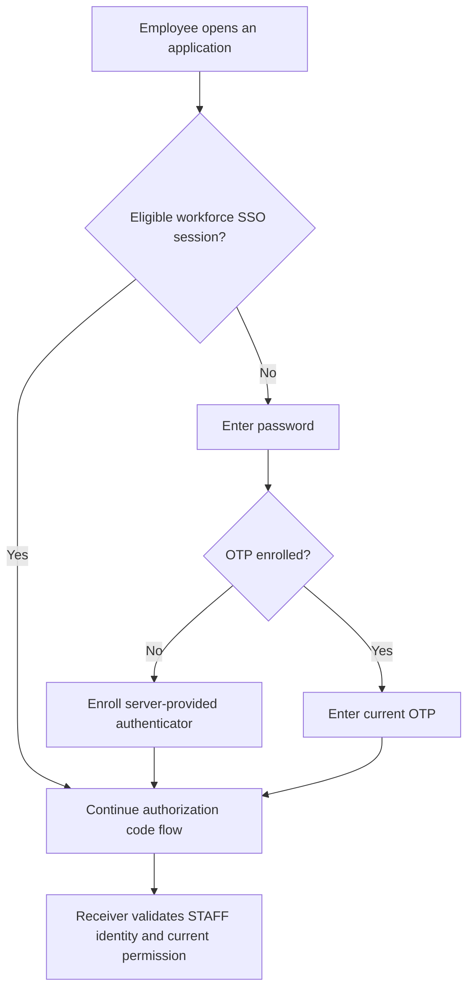

# Workforce and administration

Workforce sign-in identifies an employee. Administration controls the identity service. Acting for a customer requires a separate business permission; neither an employee session nor an administrator role supplies it automatically.

## Configure workforce sign-in

Keep workforce in its own realm, clients and user store, with a server-managed `staff_actor_id` from the employment owner. The sandbox uses `sandbox-workforce` and `firefly-workforce-browser`.



Fresh authentication requires password and OTP. Initial enrollment is a server required action completed before code issuance. An eligible existing SSO session may be reused; the employee is not asked for a new OTP on every navigation. TOTP is not phishing resistant, so select a stronger flow for access that requires it. [Passkey setup](extended-flows.md#configure-passkeys) describes the separate passwordless configuration.

To check a workforce application, complete sign-in/enrollment, then use a fresh browser context and verify that a wrong OTP cannot finish the callback. Confirm that the valid token has the workforce issuer, `principal_kind=STAFF` and the correct staff link. Customer tokens must be refused by workforce receivers. [Authentication policies](authentication-policies.md) lists the settings.

## Manage joiners, movers and leavers

| Event | Identity task | Employment/application task |
| --- | --- | --- |
| Joiner | Provision/link through the authorized service and enroll authenticators | Establish employment, tenant membership and staff actor |
| Mover | Apply authorized link/policy changes and retire affected sessions | Re-evaluate roles, institution membership and delegation |
| Leaver or suspension | Disable access, retire sessions/refresh credentials and handle federation access | End employment/business/delegation grants and preserve required records |
| Credential loss | Use the workforce credential owner's recovery procedure | Recheck employment/security eligibility and approvals |

Never link an employee or customer by email/name alone. Where a corporate IdP owns credentials, its enrollment and recovery procedure remains authoritative. The customer credential-loss extension does not replace lost employee factors.

## Unlock a local employee account

The optional native unlock supports configured local `STAFF` identities that still have the current password and a TOTP enrolled before blocking. Workforce and customer issuers, links, clients and budgets remain separate. Master administrators, privileged realm administrators, service accounts and foreign credential stores are excluded.

Core/Domain SCA authorize only the current authentication lock. An employment, fraud or administrative hold cannot be removed through self-service. The employee signs in normally after unlock. See [native recovery](native-recovery.md).

## Establish permanent administration

Use private administrative ingress and named least-privileged accounts in the administrative plane. The approved baseline is **password followed by an already enrolled FIDO2/WebAuthn credential with user verification required**. A passwordless credential, TOTP, recovery code, SSO cookie or corporate sign-in is not an alternate factor for this profile. The catalogue's `mfaRequired` field does not build the flow, enroll accounts or grant administrative roles.

The optional `firefly-privileged-webauthn` provider ships in the native extension and targets **Keycloak 26.8.1**. Install the version-matched provider before testing a candidate. It checks the account and policy when creating a challenge and again when processing the assertion. Admission requires a currently enabled, named local nonservice account, verified email, password evidence in the current authentication session, an existing `webauthn` credential, no outstanding user required actions, and the required user-verification policy. `webauthn-passwordless` does not satisfy the second-factor check. Keycloak performs the challenge, origin, RP ID, signature and user-verification validation.

A required upstream WebAuthn execution can initiate registration when a credential is missing; see the [pinned WebAuthn authenticator](https://github.com/keycloak/keycloak/blob/26.8.1/services/src/main/java/org/keycloak/authentication/authenticators/browser/WebAuthnAuthenticator.java). This provider always routes the execution through its own guard, never schedules registration, and refuses a missing or deleted credential on either request stage. The factory permits only a required execution and disallows user setup. These are credential controls; Keycloak's actual realm and client roles still decide which Admin REST operations the named administrator may perform.

### Prepare an offline candidate

`tooling/privileged_profile.py` prepares and validates an offline realm document. It never authenticates to Keycloak, activates a profile, creates an account, changes a client or grants a role. An explicit `--realm master --acknowledge-master` supports preparation for actual master administration. Applying the profile only to a different realm does not protect master or give that realm control of other realms.

Start with a protected, complete export and a reviewed working copy. Exports may contain password hashes, WebAuthn material and client secrets; keep them outside source control with restricted custody. A partial Admin REST realm response without its complete client and pre-enrolled user inventory is insufficient. The tool's credential-type check establishes that the input describes enrollment; it cannot verify possession or establish the truth of an edited export.

Prepare these prerequisites explicitly in the working copy, using institution-approved configuration decisions:

- Keep email verification and TLS-only access enabled. Every enabled administrator must already have a permanent password, verified email and a registered two-factor `webauthn` credential, with no pending required actions. Resolve temporary bootstrap accounts before the final candidate.
- Inventory every client. Keep `security-admin-console` as the sole interactive OIDC client with authorization code flow, PKCE `S256`, the exact admin origin and the console redirect path. Disable interactive `account`, `account-console`, `admin-cli` and `broker` access. Preserve the built-in role-resource clients as noninteractive resources. Keycloak refuses configuration updates to `realm-management` outside master and to master's internal `*-realm` resources. Their `bearerOnly=true` setting prevents authorization and token issuance even when the inherited `standardFlowEnabled` flag is true; do not try to disable these protected role containers through a client update. The offline validator accepts that inert flag only for a matching internal identifier with the server-exported `realm_client=true` attribute and exported `view-realm`/`manage-realm` roles; all other client safeguards still apply. Do not remove existing role mappings.
- Explicitly disable direct password grants, implicit flow, service accounts, device authorization, CIBA and token exchange. Remove offline access from client scopes. Client-specific authentication-flow overrides are refused, including apparently equivalent overrides. The generator does not repair clients for you.
- Keep only supported native local providers and reviewed built-in flows/configuration. Custom providers, custom client attributes, federation, broker configuration, custom required actions and unsupported realm attributes are refused. Unknown audit listeners are refused instead of removed; the known `jboss-logging` and native invalidation listeners are preserved. Integrating an institution's additional collector requires a reviewed extension to the allowlist and tests.

For separate identity and administrative hosts:

```sh
python3 tooling/privileged_profile.py generate \
  --input /protected/reviewed-master-export.json \
  --output /protected/master-privileged-candidate.json \
  --realm master --acknowledge-master \
  --origin https://identity.example.com \
  --admin-origin https://identity-admin.example.com

python3 tooling/privileged_profile.py validate \
  --input /protected/master-privileged-candidate.json \
  --realm master \
  --origin https://identity.example.com \
  --admin-origin https://identity-admin.example.com
```

`--origin` is the browser authentication origin and determines the RP ID. `--admin-origin` is the console origin; it defaults to `--origin`. Both require canonical HTTPS origins without paths. The current tool deliberately refuses unsupported extensions and deployment shapes instead of guessing. Its output is created exclusively with owner-only permissions; it refuses an existing output path and never prints the realm contents.

The candidate preserves users, roles, client configuration, supported audit listeners and known built-in flow definitions. It adds a required password execution followed by the guarded WebAuthn execution and binds browser authentication to that exact sequence. Registration, reset, direct grant, Docker and first-broker bindings point to a deny flow; automatic passkeys on the password form, all supported required actions and self-service enrollment are disabled. There is no cookie, OTP, broker or optional execution in the privileged browser flow. Existing client-authentication definitions remain available for protocol handling; no client is allowed a service-account or alternate administrative grant.

Validation checks the complete supported candidate, all client inventories and overrides, flow order and requirements, registration/reset bindings, required actions, user prerequisites and user-verification policy. It is an offline configuration check. It does not prove that the server loaded the provider, that an import preserved the candidate, that roles are appropriate, or that no earlier token or action link remains usable. Do not blindly import a full export over retained master data. Review a settings-level deployment procedure, preserve accounts and journals, and compare the effective configuration after deployment.

### Supervise enrollment and transition

Enrollment is a separate, controlled preactivation operation. A person who knows only an administrator password must never be allowed to use the privileged sign-in flow to enroll or replace its second factor.

1. Establish a private setup boundary using the supported temporary bootstrap procedure. Record the named enrollment operator, approver, account, device inventory and purpose. Require supervised identity confirmation before allowing an enrollment ceremony; do not expose a password-only enrollment route to ordinary users.
2. Create permanent named accounts with narrow roles. Enroll approved physical authenticators through the actual WebAuthn registration ceremony under the final identity origin and required user verification. Assign separate named emergency accounts and devices. Verify possession and the intended Admin REST permissions before transition. A fixture or credential-type field cannot substitute for these exercises.
3. Prepare the offline candidate and review its difference from the retained configuration. Rehearse the same transition on an isolated hosted clone using synthetic users. Confirm that a missing or wrong key, missing user verification, deleted key and password-only attempt cannot create a privileged session or trigger enrollment.
4. Close ordinary administrative ingress for the supervised cutover. Retire temporary bootstrap access and secret injection. Revoke existing sessions and refresh/offline authority using the approved Keycloak procedure, and verify the expiry or refusal of already issued administrative access tokens. Account for pending password-reset, execute-actions, enrollment and other action-token links; a new browser-flow binding does not automatically invalidate every previously issued authority. Preserve the original audit and recovery journals.
5. Deploy only the reviewed configuration through the controlled transition process. Read back effective realm policies, flow executions, required actions and every client override; run positive and refusal checks with new browser contexts before reopening ingress. Confirm that old bootstrap credentials, previously issued tokens and pending action links cannot recover weaker access.
6. Retain the signed change record, narrow role inventory, refusal evidence and emergency rehearsal. Do not repair a failed transition by enabling password-only access, minting a general administrative bypass token or clearing retained failure/recovery state.

The sandbox `sandbox-bootstrap` account is for isolated evaluation only. A separate `hostname-admin` does not enforce privacy: deny public `/admin/` and administrative-realm routes at ingress and prevent direct backend access. The browser authentication origin must also be available through the authorized private route. [Deployment setup](regulated-deployment.md) explains network and TLS requirements.

### Operate separate emergency access

Use separate named emergency accounts with the same password-plus-WebAuthn-UV requirement and only the approved emergency roles. Keep their passwords and registered authenticators under separate approved custody, with dual control where required by the institution. There is no shared universal emergency secret, weaker recovery client or password-only replacement path.

Document who may request access, who approves it, how custody is released, the allowed incident scope, the maximum session window, and which independent audit collector receives the named actions. Alert on emergency sign-in and administrative changes. After use, review the incident, retire the session and any resulting temporary grants, rotate/re-enroll according to custody policy, and restore the sealed inventory. Rehearse ordinary and emergency access on the institution's actual devices and private network.

Loss of every approved administrator authenticator requires the institution's separately authorized recovery and supervised re-enrollment procedure. The offline candidate and customer credential-loss extension do not supply that authority. Do not turn an admin-token or password-reset operation into proof of the lost factor.

### Qualification and limits

Native guard tests cover admission, the missing-key registration trap, passwordless substitution, policy drift and resumed submission after enrollment removal or account disablement. Offline tests cover the complete supported candidate and deliberate downgrade/bypass mutations. Neither kind of test verifies a real WebAuthn signature or establishes physical-device acceptance.

The separate `tooling/privileged-runtime.mjs` fixture is wired into the owned hosted native runtime. Its source and offline helper tests can be checked locally without launching a browser; an actual hosted result is still required. Hosted runtime acceptance must install the candidate provider and use real Keycloak browser ceremonies with virtual FIDO2 authenticators. It must demonstrate password plus an enrolled key succeeding, then missing key, wrong key/signature, absent user verification and password-only attempts refusing without enrollment or authenticated sessions. Repeat with an existing SSO cookie and after deleting a credential between challenge and submission. Verify client override, direct-grant and required-action refusals and the old-authority cutover separately. Record actual execution status; preparing a fixture is not a passing runtime result.

The implementation follows the pinned [Keycloak 26.8.1 WebAuthn authenticator](https://github.com/keycloak/keycloak/blob/26.8.1/services/src/main/java/org/keycloak/authentication/authenticators/browser/WebAuthnAuthenticator.java) and [factory](https://github.com/keycloak/keycloak/blob/26.8.1/services/src/main/java/org/keycloak/authentication/authenticators/browser/WebAuthnAuthenticatorFactory.java). The hosted fixture checks the assertion signature independently when clearing the virtual authenticator's UV bit, so a UV refusal cannot be reported merely because a deliberately invalid signature was submitted.

The hosted fixture uses a handcrafted fresh realm and a controlled transition. It does not import the exact output of `privileged_profile.py`; candidate import/readback compatibility and retained-master cutover require separate acceptance. Physical key inventory, attestation policy, administrator role approval, private ingress, lost-factor owners, emergency custody and institutional/regulatory acceptance remain separate decisions and exercises. No real administrator account or emergency-access process is activated by this repository change.

## Support staff acting for a customer

A support action needs current authority binding the real operator, customer, tenant, case/call, action/resource, purpose, expiry and any approvals. Preserve employee attribution throughout Domain/Core calls. Viewing information and initiating a payment are different permissions.

A customer PIN check provides only scoped knowledge evidence. The support/BPO case authorization owner is not supplied, so support verification remains unavailable until it is integrated. Do not impersonate the customer, hand an employee their refresh token or treat a service credential as customer proof. Follow [support PIN](support-pin.md) and [zero trust](zero-trust.md).

## Make administrative changes carefully

Password replacement does not unlock a permanent block. Failure-counter clearing is not a recovery procedure. The managed native extension vetoes generic re-enablement of tracked locks; use the bound recovery operation. Privileged PIN revocation follows its separate permission and real administrator attribution.

Disabling a user or retiring sessions also requires application-side revocation/current-state handling for already issued JWTs. For interrupted recovery, preserve the original journal and budgets. Use [incident handling](observability-incidents.md) rather than clearing state to force a retry.
