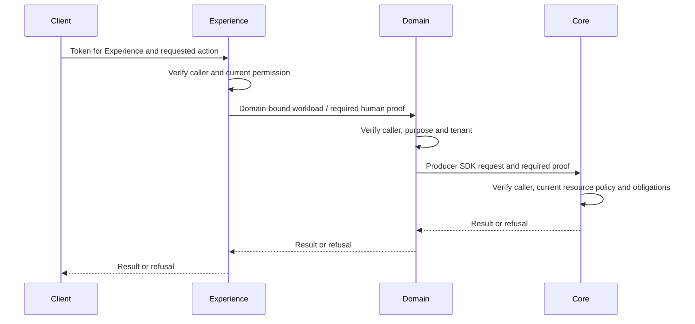

# Authorize every service request

Firefly Identity authenticates a person or workload. Each receiving service authenticates its actual caller and authorizes the requested operation. A trusted gateway, private network or successful sign-in does not transfer that responsibility to another layer.

## Validate at each boundary

The diagram illustrates the optional Experience/Domain/Core service topology. Apply the same boundary checks to your own application topology; using Identity does not require these layers or a particular framework. A receiver-specific token/delegation mechanism must exist for each enabled path; this distribution does not configure general human token exchange between all applications.

| Boundary | Authentication and authorization inputs |
| --- | --- |
| Browser to Experience | Exact trusted issuer, intended audience, signature/time, application session and CSRF where applicable, current actor/purpose/resource permission |
| Experience to Domain | Genuine workload identity plus independently verified human proof where required; exact tenant, action and resource |
| Domain to Core | Producer SDK request, preserved original identity/proof and fresh Core authorization against authoritative data |
| Native recovery service boundary | Separate private workload credential, exact ceremony/purpose/phase and current native admission; ordinary API tokens are not recovery authority |

Reject unsigned `X-Actor` headers, caller-selected actor IDs and browser claims as authentication. The service may accept a requested resource identifier, but it must bind that resource to the verified actor and current tenant before use.

## Separate authentication from business authorization

For token admission, validate signature, exact issuer, audience, approved algorithm, expiration and applicable not-before. Then project a verified principal and check its required population/tenant fields. The [application integration guide](integration-contract.md) explains the protocol and receiver configuration.

For the business decision, resolve the authoritative customer/staff link, current membership, resource ownership, consent, purpose and applicable assurance. Preserve both the opaque identity namespace and Configuration's separately typed resource-tenant UUID. A party ID identifies a relationship; it does not authorize every record linked to that person.

Ask the current policy owner about the actual action/resource. Treat an empty, stale, unavailable, failed or indeterminate result as refusal. Fulfill obligations such as step-up, maker/checker, amount limits or time restrictions before mutation. If the receiving layer cannot guarantee an obligation, it must refuse rather than pass the obligation to an untrusted caller.

Recheck authority at the point where an operation commits when asynchronous work may outlive a token, binding observation or authorization. Use bounded deadlines and preserve a durable decision/execution record without logging bearer tokens or credential material.

## Configure current-state enforcement

Offline JWT validation proves that the token was correctly issued and is within its accepted time constraints. It cannot, by itself, discover that the user was subsequently blocked, an employment link changed or an application session was revoked.

Choose the required behavior for each API:

- If bounded token lifetime is sufficient, document the expiry window and ensure the application does not extend it silently.
- If immediate blocking is required, use the supported online current-state/introspection mechanism and configure bounded caching, invalidation and fail-closed outage behavior.
- If the application maintains its own session, revoke or revalidate that session as part of the lifecycle; issuer logout cannot operate an unrelated application store automatically.

Native recovery terminates relevant identity sessions and advances user not-before. Every receiving service still needs the selected enforcement mechanism. [Audiences and introspection](receiver-audiences.md) explains receiver identity; [architecture](architecture.md) explains joiner/mover/leaver ownership.

## Keep workloads and human delegation distinct

Client credentials establish software identity. They cannot establish a customer's knowledge, possession, consent or authorization by carrying a supplied customer ID. For a human operation across service hops, use a supported signed proof/delegation contract binding original issuer/subject, tenant, intended receiver, purpose, delegating client and bounded lifetime.

Do not forward a token to an API outside its audience. Do not infer raw bearer authority from a projected principal, and do not replace an employee's identity with a customer's refresh token. Where no compatible delegation contract is available, disable that operation until the owning services provide one.

Firefly-specific native credentials, locks and PINs stay in Identity. Business adapters stay with their actual service owners. Ordinary application authentication requires the configured OIDC/OAuth 2.0 interfaces, without a dependency on native recovery or a proofing provider.

## Staff acting for a customer

Authenticate the employee through the workforce issuer and retain the real employee identity in every audit record. Acting for a customer requires separate current authority for the operator, customer, tenant, case, action/resource, expiry and required approvals. Employment/provider changes and delegation revocation must affect access according to the selected enforcement policy.

Observation, telephone support, privileged mutation and financial initiation are different permissions. A customer support PIN is only a scoped knowledge credential; it does not create an operator mandate or substitute for possession proof. Support verification remains unavailable until a genuine support case/call authorization owner is integrated.

Self-service account recovery is also a distinct purpose. It cannot authorize BPO access, staff impersonation or a payment. Use [support PIN](support-pin.md), [workforce administration](workforce-administration.md) and [the recovery journey guide](access-recovery.md) to select the appropriate ownership and controls.
